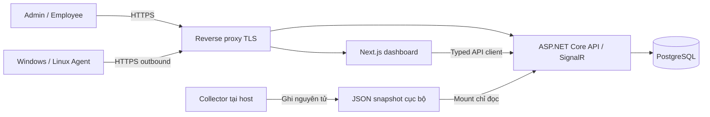

# Bối cảnh và topology

SentinelLAN quản lý các thiết bị đầu cuối được tổ chức cho phép. Admin dùng dashboard để quản trị; Employee xem thiết bị được gán. Agent trên máy được quản lý gửi telemetry kỹ thuật qua HTTPS. Giám sát host tùy chọn dùng collector systemd tại host và JSON snapshot cục bộ; API chỉ đọc file, không kết nối SSH.

Trong Development, `compose.yaml` chạy PostgreSQL, API và web; Agent chạy trên host. Stack Production trong `deploy/vps/` thêm Nginx TLS và không tạo dữ liệu demo. Các bước vận hành nằm trong [hướng dẫn LAN](../deployment/self-hosted-guide.md) và [hướng dẫn VPS](../deployment/saas-vps-guide.md). Redis không thuộc stack đang dùng.

Mỗi yêu cầu phải kiểm tra quyền và `OrganizationId` tại boundary ứng dụng. Tenant scope hiện được áp dụng tường minh trong truy vấn; có EF Core global query filter bổ sung, chưa có database row-level security. Audit được bảo vệ khỏi sửa/xóa qua `SentinelDbContext`, chưa phải sổ cái bất biến ở mức database. Xem [mô hình đe dọa](../security/threat-model.md) và [các thành phần](components.md).

Lệnh Agent `SimulateLock` và `SimulateNetworkIsolation` chỉ mô phỏng. Adapter Windows thực thi thông báo, restart service, policy và lệnh lab `LockWorkstation`/`IsolateNetwork` khi được cấu hình/ủy quyền, rồi kiểm tra trạng thái thực tế; xem [hướng dẫn thực thi](../guides/real-agent-execution.md). API không công bố restart/reboot VPS. Chỉ Admin của đơn vị vận hành được cấu hình mới xem được snapshot host; xem [vận hành host](../deployment/vps-operations.md).
