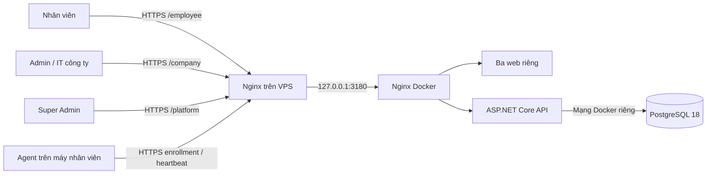

# SentinelLAN trên vps-cong — 2026-10-02

Địa chỉ tạm: `https://sentinellan.149.118.50.176.sslip.io`.

| Cổng | Đường dẫn | Tài khoản ban đầu |
|---|---|---|
| Nhân viên | `/employee/login` | Admin công ty cấp tài khoản và link kích hoạt |
| Admin / IT công ty | `/company/login` | Mã công ty `sentinellan`, email `admin@sentinellan.local` |
| Super Admin / Chủ hệ thống | `/platform/login` | Email `owner@sentinellan.local` |

Mật khẩu ngẫu nhiên chỉ ở `/opt/sentinellan/shared/.env` trên VPS, quyền `0600`, root sở hữu. Hai email trên là định danh đăng nhập, không phải hộp thư được cấu hình. Không có dịch vụ gửi email; link kích hoạt cần được quản trị gửi cho đúng người. Không dùng mật khẩu demo ở production.

Đọc riêng mật khẩu đăng nhập trong terminal cá nhân:

```powershell
ssh vps-cong "sudo grep -E '^(BOOTSTRAP_ADMIN_PASSWORD|PLATFORM_OWNER_PASSWORD)=' /opt/sentinellan/shared/.env"
```

## Kết nối



Các vai trò làm việc qua API chung, không kết nối trực tiếp với nhau hoặc PostgreSQL. Tenant của Admin/nhân viên là công ty; Super Admin có session và quyền riêng. Backend đọc/ghi PostgreSQL bằng EF Core, kiểm tra quyền/tenant và ghi audit.

Super Admin tạo công ty và cấp link kích hoạt Admin. Admin kích hoạt, cấp tài khoản nhân viên, cấp enrollment token, enroll Agent và gán thiết bị cho nhân viên. Sau khi nhân viên đăng nhập, hệ thống tự chọn máy đã gán; nhân viên gửi yêu cầu, Admin/IT nhận và trả lời, nhân viên thấy trạng thái xử lý. Chưa gán thiết bị thì không gửi được yêu cầu hỗ trợ máy.

Trên máy nhân viên, `SENTINELLAN_API_URL` phải là HTTPS origin của VPS. Cần cài và enroll Agent để có heartbeat liên tục. Việc kiểm thử giao thức API bằng thiết bị `DEPLOY-CHECK-API-HANDSHAKE` không thay thế nghiệm thu Agent trên máy nhân viên. Khóa/cô lập thật giữ trạng thái tắt.

## Vị trí và vận hành

- Mã nguồn đang chạy: `/opt/sentinellan/current`, trỏ tới release `/opt/sentinellan/releases/20261002-3c38758` có các bản sửa deployment và web.
- Environment: `/opt/sentinellan/shared/.env`; giữ lại khi đổi release. Thay biến bootstrap không thay mật khẩu tài khoản đã tồn tại.
- Nginx host: `/etc/nginx/sites-available/sentinellan.conf`. Chỉ thêm site riêng, giữ nguyên site khác.
- TLS: `/etc/letsencrypt/live/sentinellan.149.118.50.176.sslip.io/`, gia hạn qua timer Certbot và reload Nginx sau gia hạn.
- Backup: `/opt/sentinellan/shared/backups`, root đọc; `sentinellan-backup.timer` chạy mỗi ngày khoảng 02:17 UTC (09:17 giờ Việt Nam), có độ lệch tối đa 5 phút. Chưa cấu hình backup sang máy khác hoặc chính sách tự xóa bản cũ.
- PostgreSQL: volume `sentinellan-prod_sentinellan-prod-postgres`, mount `/var/lib/postgresql`. PostgreSQL 18 dùng thư mục dữ liệu theo phiên bản; xem [hướng dẫn image chính thức](https://hub.docker.com/_/postgres). Với volume cũ đã có dữ liệu, cần backup và di chuyển cấu trúc trước khi đổi mount.
- Database/API/ba web không publish cổng ra Internet. Gateway chỉ bind `127.0.0.1:3180`; host Nginx phục vụ HTTPS 443.
- Đây là database production mới trên VPS. Không nhập dữ liệu development/in-memory hoặc database cũ chưa được chỉ định.
- Portal Super Admin nằm ngoài Git theo `.gitignore`; phải đóng gói riêng từ `apps/platform`, bỏ `.next`, `node_modules`, report và bí mật, khi cập nhật bản triển khai.
- Trạng thái Backend/PostgreSQL được xác minh trong Super Admin. Chưa đăng ký node giám sát SSH cho VPS trong portal; SSH triển khai từ máy quản trị đã kết nối thành công.

```bash
cd /opt/sentinellan/current
sudo docker compose --env-file /opt/sentinellan/shared/.env \
  -f deploy/vps/docker-compose.prod.yaml \
  -f deploy/vps/docker-compose.host-proxy.yaml ps

curl --fail https://sentinellan.149.118.50.176.sslip.io/health/ready

sudo docker compose --env-file /opt/sentinellan/shared/.env \
  -f deploy/vps/docker-compose.prod.yaml \
  -f deploy/vps/docker-compose.host-proxy.yaml up -d --build
```

Không dùng `down -v`, không xóa volume khi cập nhật. Khi đổi tên miền, cập nhật `PUBLIC_DOMAIN`, chứng chỉ/site Nginx và build lại ba web vì API URL được nhúng lúc build.

## Kiểm chứng

- 238 test .NET chạy thành công trong Docker Linux: Domain, Application, Infrastructure/API integration, architecture và Agent.
- Web lint, typecheck và 34 test shared UI chạy thành công sau cập nhật. Audit dependency production của ba web trả về 0 vulnerability. Ba Docker image web build thành công với Next.js `16.3.8`.
- Ba web được cập nhật Next.js/eslint-config-next `16.3.8`, shared UI peer version tương ứng. Xem [security advisory của Next.js](https://github.com/vercel/next.js/security/advisories/GHSA-vcvr-r3jv-pc5j). Cảnh báo dependency không khẳng định ứng dụng đã bị khai thác.
- HTTPS từ cả VPS và máy Windows: `/health/live`, `/health/ready`, ba trang đăng nhập đều HTTP 200.
- 22 kiểm tra luồng trực tiếp đạt: Super Admin tạo/kích hoạt công ty; Admin cấp/kích hoạt nhân viên; enrollment/heartbeat/gán máy; nhân viên tạo phiếu, Admin nhận/trả lời, nhân viên xem kết quả; dữ liệu và audit được lưu; tenant isolation, phân quyền và CSRF từ chối đúng thao tác sai.
- Playwright Chromium đăng nhập được cả ba cổng qua HTTPS; Super Admin hiện `VPS Backend: Online`, Admin có session/dashboard, nhân viên thấy thiết bị được gán. Không có lỗi runtime trình duyệt; nút điền mật khẩu demo không xuất hiện ở production.
- Backup đã tạo và phục hồi thử thành công 36 bảng trong database tạm, không ghi đè database production.
- Đã thu hồi thiết bị kiểm thử, tạm ngưng công ty kiểm thử, xóa mật khẩu nghiệm thu tạm; giữ audit để đối chiếu.

Kiểm tra luồng bằng tenant riêng tên `Kiem thu trien khai VPS ...`, tài khoản chỉ dùng cho nghiệm thu, thiết bị được ghi rõ là kiểm tra API. Sau kiểm tra, thu hồi thiết bị và tạm ngưng tenant; giữ lại audit.
