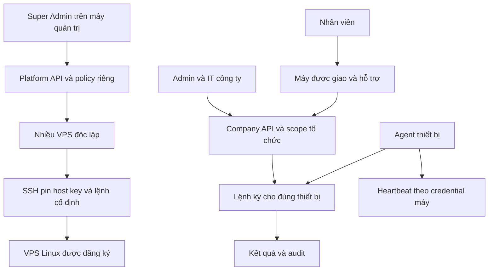

# Quyền, luồng và nhiều VPS

Đối chiếu source ngày 01/10/2026. Giới hạn được ghi riêng, không coi là tính năng đã có.

## Ma trận quyền

| Vai trò | Được làm | Bị chặn |
|---|---|---|
| Super Admin / PlatformOwner | Quản lý công ty, lời mời Admin, tạm ngưng/mở lại; đọc tổng quan công ty; quản trị các VPS nền tảng | Company API điều khiển endpoint/telemetry chi tiết/lệnh và phiên đăng nhập công ty |
| Admin công ty | Tài khoản, enrollment, gán/thu hồi máy, thiết bị, lệnh được phép, chính sách, hỗ trợ và audit trong tổ chức | Platform/VPS và tài nguyên tổ chức khác |
| IT / Technician | Thiết bị, lệnh được phép, chính sách, cảnh báo, hỗ trợ/bảo trì trong tổ chức | Platform/VPS, cấp tài khoản/enrollment, gán/thu hồi máy, audit quản trị |
| Employee | Máy chưa thu hồi được gán cho mình, hỗ trợ và dữ liệu công bố theo quyền | Máy người khác, lệnh quản trị trực tiếp, Company management và Platform API |
| Agent | Heartbeat, nhận lệnh/trả kết quả cho đúng máy bằng credential riêng | Phiên người quản trị, máy/tenant khác, shell tùy ý |

IT hiện quản lý trong toàn tổ chức, chưa giới hạn inventory theo từng nhóm IT. Assignment của yêu cầu hỗ trợ không phải ranh giới quyền toàn bộ thiết bị.

Super Admin có API riêng đọc tên/email/vai trò/trạng thái người dùng, metadata thiết bị, một số cảnh báo và audit của công ty. Không được gọi là hoàn toàn không thấy dữ liệu công ty. Tạm ngưng công ty cũng ảnh hưởng cả tenant dù không phải lệnh endpoint.

Người nắm root/SSH/DB có quyền hạ tầng mạnh hơn role web. Phân quyền ứng dụng không bảo vệ trước người đã nắm root/database; cần bảo vệ và tách quyền hạ tầng.

## Điểm chặn server

1. `AccessTokenAuthenticationHandler` chỉ chấp nhận PlatformOwner ở `/api/v1/platform`; phiên đó bị từ chối ở API khác. Phiên công ty bị từ chối ở Platform. Cookie nền tảng có tên/path riêng. Kiểm tra user active, role/SecurityStamp và công ty chưa tạm ngưng.
2. `Permissions`/policy endpoint chặn theo role; menu không thay thế kiểm tra server.
3. `DeviceScope` và use case lọc `OrganizationId` lấy từ actor xác thực. Employee chỉ thấy máy chưa thu hồi được gán cho mình. ID device/user/ticket phải cùng tổ chức.
4. Lệnh endpoint có allowlist, reason, confirmation, expiry, nonce và chữ ký. Agent kiểm tra đúng device/chữ ký/thời gian/replay. Install/Pause/Uninstall phải qua hỗ trợ phê duyệt/OTP, không gửi lệnh trực tiếp; không có shell tùy ý.
5. `VpsNodeService` kiểm tra PlatformOwner. SSH key mã hóa tại server, pin SHA256 phải được xác minh từ console tin cậy. Lệnh cố định, nonce duy nhất, expiry tối đa 5 phút và audit trước thực thi.

Lần sửa này gỡ menu/route `vps-nodes`, component VPS cũ và các phương thức SSH khỏi cổng/client công ty. URL cũ trả trang không tồn tại. Đăng nhập công ty/nhân viên bỏ link nền tảng. API server vẫn là điểm chặn quyền; ẩn link không phải cơ chế bảo mật.

## Luồng

Không có đường Owner → Company command. Agent dùng API được cấu hình cho nó, không lấy VPS từ registry. Web/mobile không điều khiển trực tiếp OS nhân viên.

## Nhiều VPS và giảm tải

- Đăng ký nhiều node độc lập với ID, host/port, username, fingerprint, SSH key mã hóa và trạng thái riêng. Registry không tự gán tenant vào VPS.
- UI render, bộ đếm và lựa chọn chu kỳ chạy trên trình duyệt admin. API nhận yêu cầu và SSH vào VPS; secret đã lưu không trả về trình duyệt. Chưa phải SSH trực tiếp/offline trên máy admin.
- Poll 1–5 phút, mặc định 3, chỉ khi trang hiển thị. Tab ẩn/unmount dừng poll; vòng hoàn tất mới đặt vòng tiếp theo. Tối đa hai probe song song trên một trang; lỗi một node không ngăn các node khác. Có làm mới theo yêu cầu.
- Khóa trong trang tránh vòng trùng và vô hiệu nút xung đột. Abort HTTP không đảm bảo tác vụ SSH đã bắt đầu được hoàn tác. Không gửi lại reboot chỉ vì mất phản hồi.
- Probe đọc CPU/RAM/root disk, uptime, systemd, dịch vụ allowlist; Docker đọc state/health/policy, CPU/RAM/I/O và lớp ghi container. I/O/kích thước lớp ghi không phải tổng image/volume/log.
- VPS chạy lệnh/probe cố định, không cài daemon poll nền. Mỗi lượt vẫn có chi phí SSH/Docker/CPU tăng theo node và số admin đang xem.

## Giới hạn

| Chủ đề | Hiện tại / cần bổ sung |
|---|---|
| Dự phòng | Registry nhiều VPS không phải HA. Chưa có tự chuyển API/DB/Agent, LB hay DB replication. Cần thiết kế và diễn tập riêng. |
| Điều phối | Hai probe/trang và rate limit API; chưa có lease/khóa chung theo node hoặc coalescing giữa admin/replica. Tránh nhiều người thao tác cùng node. |
| Theo dõi nền | Không ai mở trang thì chức năng này không có probe VPS/cảnh báo ngoài giờ tự động. |
| Startup | Cần Docker daemon enabled, policy/Compose tương thích. Startup không chứng minh app khỏe hoặc DB đúng. |
| Agent delivery | Lease 30 giây, nonce, receipt retry; crash sau ghi nonce trước lưu receipt có thể không biết đã chạy. Không hứa exactly-once kết quả. |

Chưa nghiệm thu HA, mất điện, VPS thật hay root bị chiếm quyền; source/test không thay thế diễn tập.

## Nguồn đối chiếu

- `Api/AccessTokenAuthenticationHandler.cs`, `Endpoints/CommandEndpoints.cs`, `PlatformApi`.
- `Application/Common/Permissions.cs`, `Devices/DeviceScope.cs`, `VpsNodes/VpsNodeService.cs`.
- `Infrastructure/Platform/PlatformStore.cs`, `VpsCommandCatalog.cs`.
- `apps/platform/src/components/vps-monitor.tsx` (cục bộ).
- `PlatformIntegrationTests`, `VpsOperationsApiTests`: phiên tách biệt, công ty bị chặn VPS; test đọc company summary còn thử gửi command/gán lại/thu hồi cùng device và xác nhận 401, không đổi device hay tạo command. `VpsNodeServiceTests`: role, validation, replay. Giữ các test tenant/Agent khi sửa quyền.

Kiểm tra trong lần sửa này: 5 integration test Platform/VPS, 34 web unit test, lint/typecheck web (bao gồm portal riêng tại máy này), build production cổng công ty đều đạt. Integration dùng môi trường test, không phải SSH/reboot hoặc failover VPS thật.
