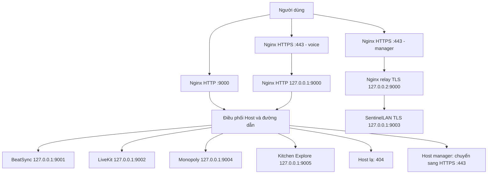

# Quy ước và định tuyến VPS-Cong

Cập nhật ngày **10/10/2026**, đối chiếu trực tiếp cấu hình Docker/Nginx đang chạy. Quy ước này áp dụng cho các dự án của chủ tài khoản: BeatSync, LiveKit, SentinelLAN, Monopoly và Kitchen Explore. Mọt Mẻ Bánh là dự án của người khác trên VPS dùng chung.

## Quy ước

- Cổng ứng dụng mở trên mạng của VPS phải bind **127.0.0.1 và lớn hơn 9000**.
- Nginx dùng **9000** làm gateway chung. Không có hai ứng dụng cùng chiếm một địa chỉ/cổng/giao thức trên VPS.
- Cổng 3000, 3001, 8443, 5432 bên trong mạng Docker không chiếm cổng của VPS; chúng có thể lặp trong các container có mạng riêng.
- Không sửa site mặc định /etc/nginx/sites-available/default; không thay cấu hình, nguồn hoặc container của Mọt Mẻ Bánh.
- Không cài Cloudflare Tunnel trên VPS dùng chung.
- Giữ HTTPS, xác minh chứng chỉ upstream, quyền Admin và giới hạn đăng nhập cho SentinelLAN.

## Danh sách cổng hiện tại

| Dự án | Cổng trên VPS | Cổng trong container | Tuyến web |
|---|---|---|---|
| BeatSync | 127.0.0.1:9001 HTTP | Không dùng Docker; systemd beatsync | beatsync-server.zney295.id.vn/ |
| LiveKit | 127.0.0.1:9002 HTTP/WebSocket | 7880 | voice.zney295.id.vn/ |
| SentinelLAN | 127.0.0.1:9003 TLS | Gateway 8443 | manager.zney295.id.vn/company, /employee, /api |
| Monopoly | 127.0.0.1:9004 HTTP/WebSocket | 3001 | beatsync-server.zney295.id.vn/monopoly/ |
| Kitchen Explore | 127.0.0.1:9005 HTTP/WebSocket | 3001 | beatsync-server.zney295.id.vn/kittens/ |

Monopoly trước đây dùng3110, Kitchen Explore dùng3105. Hai cổng cũ đã bỏ; image game giữ nguyên. API/web/database SentinelLAN và các database khác không mở cổng ứng dụng ra host. Hai web SentinelLAN dùng localhost:3000 trong hai mạng riêng; mỗi sidecar TLS chia sẻ mạng với web tương ứng và nghe3443.

Mọt Mẻ Bánh vẫn có127.0.0.1:3080; đây là ngoại lệ ngoài phạm vi các dự án của chủ tài khoản.

## Sơ đồ gateway

Nginx HTTP9000 bind riêng127.0.0.1, IP interface chính10.0.1.22, và[::] IPv6. Không dùng wildcard IPv4 0.0.0.0:9000 vì127.0.0.2:9000 được dành cho relay TLS chỉ truy cập trên VPS.127.0.0.2 cũng thuộc loopback. Relay TCP không giải mã TLS; HTTPS site manager tiếp tục kiểm tra CA và tên gateway khi kết nối xuyên qua9000 đến9003.

Không đổi Cloudflare origin rule của manager/voice sang HTTP9000. Các URL HTTPS đang dùng443 tiếp tục hoạt động và đi qua gateway9000 bên trong VPS. LiveKit UDP50000–50100 là lưu lượng media, đi trực tiếp theo cấu hình hiện hữu, không phải tuyến HTTP/WebSocket.

Static game được Nginx phục vụ trực tiếp từ /var/www/monopoly và /var/www/exxplore-kittens; health và Socket.IO đi tới backend9004/9005.

## Cấu hình và bảo trì

- /etc/nginx/sites-available/port_9000.conf: điều phối HTTP.
- /etc/nginx/snippets/project-gateway-http-listen.conf: các địa chỉ HTTP9000.
- /etc/nginx/project-gateway-tls.conf: relay loopback TLS127.0.0.2:9000 →127.0.0.1:9003, include ngoài http{} trong nginx.conf.
- /etc/nginx/sites-available/sentinellan-manager.conf và sentinellan.conf: upstream TLS qua127.0.0.2:9000.
- /etc/nginx/sites-available/voice-public.conf: HTTPS voice qua gateway HTTP localhost9000.
- /etc/nginx/snippets/monopoly-locations.conf và kittens-locations.conf: backend mới9004/9005.
- /etc/nginx/conf.d/project-gateway-forwarded.conf: chỉ tin header scheme/client IP từ frontend loopback.
- Khi IP interface VPS thay đổi, cập nhật listen IPv4 HTTP trong snippet và default gateway trước khi nginx-t/reload.
- Thêm dự án mới ở cổng localhost>9000 còn trống, thêm Host/route trong gateway, cập nhật sơ đồ và kiểm tra HTTP/WebSocket.
- Thay cổng game cần thay container; chỉ làm khi không có kết nối đang chơi và giữ image đang chạy.

Backup và trạng thái chuyển cổng: /var/backups/sentinellan-project-gateway/20261009T202927Z (tên thư mục dùng UTC). Công cụ deploy/vps/standardize-project-gateway.py là migration một lần từ cổng cũ, có plan/apply/verify/rollback, kiểm tra Nginx trong bản sao trước khi áp dụng, khóa triển khai và guard kết nối. Rollback cũng yêu cầu game không có kết nối.

Tệp triển khai Monopoly/Kitchen Explore đã đổi về9004/9005, gồm Compose, Nginx snippet, health check và guard cập nhật. Installer Kittens nhận snippet listen chung nếu tồn tại, tránh ghi đè bằng wildcard9000 trong lần triển khai sau.
