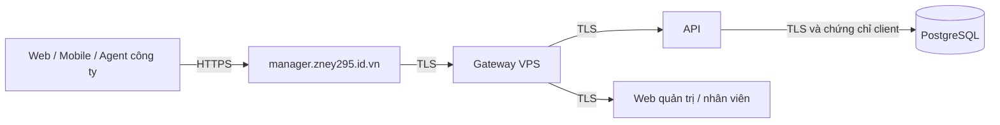

# Kiểm tra kết nối SentinelLAN — 24/10/2026

Máy chủ đang dùng: **vps-cong**, địa chỉ chính **https://manager.zney295.id.vn**. Chế độ thực tế là `Production / SelfHost`, dùng nội bộ một công ty. Mã nội bộ trong cơ sở dữ liệu vẫn là `zney295`; người dùng không cần nhập mã này khi đăng nhập.

Đã kiểm tra bằng yêu cầu thật từ máy Windows và từ VPS. Bài kiểm tra ngoài Internet có **50 mục: 48 đạt, 2 mục liên kết ứng dụng native chưa cấu hình**. Không cài Agent, không tạo thông tin xác thực cho máy mẫu, không gửi lệnh xuống thiết bị. Các lần đăng nhập dùng để kiểm tra đều đã đăng xuất.

| Môi trường / đường kết nối | Kết quả và bằng chứng | Giới hạn |
| --- | --- | --- |
| Internet → tên miền chính | DNS phân giải; HTTPS xác thực thành công, TLS 1.3; HTTP chuyển 308 sang HTTPS | Chứng chỉ công khai tại thời điểm kiểm tra hết hạn 01/01/2027; cần duy trì gia hạn tự động |
| Web quản trị và web nhân viên | Hai trang đăng nhập HTTP 200; mỗi trang tải đủ 8 tệp JavaScript cùng tên miền; không thấy địa chỉ API local sai trong các tệp đó | Kiểm tra HTTP và nội dung tải về; công cụ trình duyệt đang bị tắt nên chưa kiểm tra lại bằng thao tác giao diện |
| Web → API | Đăng nhập không gửi mã công ty thành công, nhận vai trò Admin; đọc phiên, dashboard, 13 tài khoản, 12 máy và tình trạng VPS đều 200 | 12 máy là dữ liệu mẫu, không phải 12 Agent online |
| Phiên web | Cookie Secure + HttpOnly + SameSite=Strict; refresh đổi cookie; thiếu CSRF bị 400; đăng xuất 204, phiên sau đó 401 | Chỉ tạo và kết thúc các phiên phục vụ kiểm tra |
| CORS | Tên miền chính được cho phép; origin lạ không được cấp Access-Control-Allow-Origin | Tên miền sslip.io cũ vẫn là alias tương thích trong cấu hình VPS, không phải một công ty khác |
| Cập nhật trực tiếp | SignalR negotiate 200; bắt tay JSON thành công qua WSS; yêu cầu chưa đăng nhập bị 401 | Chưa phát sinh heartbeat từ máy thật để kiểm tra cập nhật thiết bị đầu cuối |
| Proxy máy chủ → gateway | Cổng nội bộ 9003 và relay TLS 127.0.0.2:9000 trả readiness thành công, có xác thực CA | Các địa chỉ loopback này thuộc hạ tầng VPS, không phải địa chỉ đưa cho Agent hoặc điện thoại |
| Gateway → API / hai web | Gọi trực tiếp API:8443, company:3443, employee:3443 đều 200, kiểm tra chứng chỉ TLS thành công | HTTP từ sidecar đến Node chỉ ở loopback trong cùng không gian mạng của web |
| API → PostgreSQL | Quan sát 2 phiên TLS 1.3, cipher TLS_AES_256_GCM_SHA384, có chứng chỉ client | Số phiên thay đổi theo connection pool; không xuất dữ liệu hay mật khẩu |
| Chứng chỉ nội bộ | 5 chứng chỉ server, 1 client DB và CA đều còn hơn 30 ngày; server/client hết hạn 02/10/2027, CA 01/10/2031 | Không thay hay xoay khóa trong đợt kiểm tra này |
| Cổng riêng của dịch vụ | PostgreSQL, API, hai web không publish ra host; gateway chỉ bind 127.0.0.1:9003. Thử từ ngoài đến 3000/3001/5432/8080/9003 đều timeout | Đây là kiểm tra các cổng liên quan, không phải kiểm toán toàn bộ firewall |
| Mobile → API thật | Đăng nhập Bearer nhận Admin; đọc dashboard, users, devices, VPS; refresh đổi token và logout thành công; refresh sau logout bị 401 | Chưa thao tác trên điện thoại thật |
| Dữ liệu mobile | Phản hồi thật khớp schema mobile cho bootstrap, dashboard, users, devices, hỗ trợ, catalog, thông báo, hướng dẫn; đọc được tin nhắn và danh sách tệp đính kèm | Không thử gửi ảnh, sửa yêu cầu hay duyệt cài phần mềm trên thiết bị thật |
| Báo cáo lỗi mẫu | 12 yêu cầu: 4 Open, 2 InProgress, 1 AwaitingEmployee, 3 Resolved, 2 Closed | Dữ liệu được đánh dấu mẫu |
| Kho ứng dụng | Firefox ESR và PuTTY có đường tải HTTPS cùng tên miền; HEAD trả 200 và kích thước tệp hợp lệ | Cài tự động vẫn cần cấu hình và thử trên máy được IT cho phép |
| Expo Go / Metro | Máy phát triển 192.168.88.201:8081 phục vụ manifest Android và bundle HTTP 200; manifest API/web đều là tên miền thật | Điện thoại phải cùng mạng và truy cập được máy này; chưa xác nhận đường từ điện thoại qua Wi-Fi/firewall |
| EAS development / preview / production | Đã thực thi Expo config cho cả ba profile: API/web đều trỏ tên miền thật. Production từ chối localhost và HTTP emulator | Chưa tạo APK/IPA hay cấu hình tài khoản phát hành |
| Agent / Setup 0.2.24 | Agent chạy chế độ chỉ đọc trả đúng HTTPS, CompanyPinned=true, có khóa công khai, version 0.2.24.0. Bằng chứng Setup xác nhận MSI nhúng đúng bản và đúng SHA-256 | Setup yêu cầu quyền Windows Admin; kiểm tra trước đó qua managed entry point và giải nén MSI, không chạy cài đặt. Các tệp hiện chưa ký Authenticode |
| Agent đã cài trên máy này | Không có agent-settings.json ở vị trí cài đặt ProgramData tiêu chuẩn | Chưa có bằng chứng cài/enroll/heartbeat trên máy Windows thật |
| Docker phát triển cục bộ | Compose kiểm tra cú pháp thành công; localhost trong cấu hình Development là chủ ý | Docker Desktop không chạy; web local 3000/3001 và API 8080 không chạy, chưa kiểm tra runtime local |
| Mẫu triển khai LAN riêng | Compose kiểm tra cú pháp thành công với biến thử | Chưa có máy chủ LAN để chạy; cần DNS/HTTPS được các máy tin cậy. Mẫu LAN cơ bản dùng HTTP giữa container, khác hệ thống VPS hiện đã bật TLS nội bộ |
| Redis / S3 / thông báo đẩy | Không có cấu hình kết nối Redis/S3 trong môi trường API đã quan sát; Expo chưa có EAS projectId | Không coi các tích hợp tùy chọn này là đã thử thành công; push trên bản cài riêng cần hoàn tất EAS và thông tin dịch vụ |
| Mở ứng dụng từ liên kết HTTPS | Hai tệp /.well-known/assetlinks.json và /.well-known/apple-app-site-association trả 404 | Cần SHA-256 chứng chỉ ký Android và Apple Team ID thật trước khi xuất bản; Expo Go thử đăng nhập không phụ thuộc hai tệp này |

Luồng đang hoạt động:

Đã sửa trong mã nguồn cấu hình: bỏ mặc định localhost của API web, hub cập nhật và CSP; mobile mặc định về tên miền công ty, kiểm tra origin, chặn địa chỉ loopback ở bản phát hành; cả ba EAS profile dùng HTTPS thật. Sửa mã công ty trong mẫu manager.env.example thành zney295. Bổ sung kiểm tra hạn chứng chỉ client DB và CA. Expo Metro đã đọc được cấu hình mới. Web trên VPS vốn được build với API cùng tên miền (`NEXT_PUBLIC_API_URL=""`) và đã kiểm tra thành công; đợt này không thay image API/web đang chạy. Các thay đổi bảo vệ giá trị mặc định web sẽ có trong lần build triển khai tiếp theo.

EAS được ghim Node 24.17.0 theo phiên bản tối thiểu của repository, để trình đọc cấu hình hỗ trợ import TypeScript dùng chung với ứng dụng. Việc kiểm tra Expo config cục bộ chạy trên Node 24.18.0; chưa chạy cloud build EAS.

Kiểm tra mã nguồn đạt: 237 bài mobile, 27 bài web liên quan kết nối/CSP, typecheck và lint mobile/web-ui, production build cả hai web, kiểm tra cú pháp 3 bộ Compose và kiểm tra 7 chứng chỉ thật. Một lần chạy mobile có cảnh báo React trong tình huống kiểm thử lỗi; toàn bộ 237 bài vẫn đạt.

Có thể chạy lại kiểm tra ngoài Internet bằng Node 24: `node scripts/verify-connections.mjs`. Đặt `SENTINELLAN_CONNECTION_CHECK_EMAIL` và `SENTINELLAN_CONNECTION_CHECK_PASSWORD` trong môi trường tiến trình nếu cần thử phiên Admin; không ghi chúng vào tài liệu hoặc Git. Script chỉ đọc dữ liệu và tạo/refresh/đăng xuất phiên thử, không enroll máy hay gửi lệnh. Kết quả không chứa token, cookie hoặc mật khẩu, nằm tại `dist/connection-audit-20261024/public.json`; đối chiếu các profile tại `dist/connection-audit-20261024/mobile-config.json`. Các tệp dist là bằng chứng cục bộ, không được commit.

Để hoàn tất thử nghiệm đầu cuối, cần một máy Windows được cho phép chạy bộ cài công ty 0.2.24 và một điện thoại thật. Xác nhận máy xuất hiện online và telemetry mới; sau đó thử báo lỗi, nhận phản hồi và quy trình xin cài phần mềm. Giữ bản Agent tương thích với API hiện đang chạy; không sử dụng bộ cài cũ hoặc tự đổi URL sang localhost.
