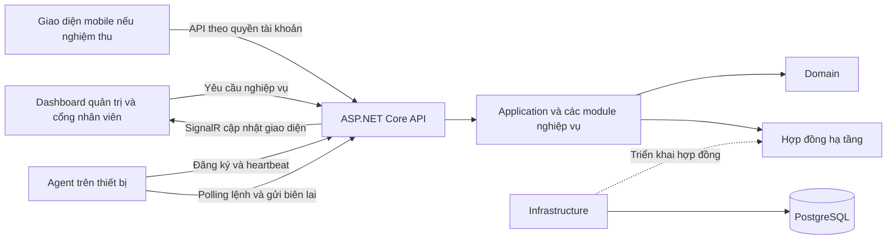

# HỆ THỐNG QUẢN LÝ GIÁM SÁT VÀ BẢO MẬT THIẾT BỊ ĐẦU CUỐI TRONG MẠNG NỘI BỘ

## Thông tin bìa

ĐẠI HỌC KINH TẾ THÀNH PHỐ HỒ CHÍ MINH  
KHOA CÔNG NGHỆ THÔNG TIN  
KHÓA LUẬN TỐT NGHIỆP  
Tên hệ thống: SentinelLAN  
Sinh viên thực hiện: Lê Quang Khánh  
Mã số sinh viên: [TỰ ĐIỀN A01: mã số sinh viên]  
Lớp và khóa: [TỰ ĐIỀN A02: lớp, khóa học]  
Ngành: Công nghệ thông tin  
Giảng viên hướng dẫn: [TỰ ĐIỀN A03: học hàm, học vị, họ tên]  
TP. Hồ Chí Minh, năm 2026

[TỰ ĐIỀN A04: đối chiếu tên đơn vị, loại báo cáo, thứ tự thông tin và mẫu bìa với quy định chính thức của trường; không mặc định bố cục trên là mẫu đã được duyệt.]

## Hướng dẫn hoàn thiện bản thảo

Phần này dành cho người biên tập, cần bỏ khỏi bản nộp. Các đoạn văn ở các chương là nội dung có thể sử dụng làm bản thảo; những dấu ngoặc vuông chỉ rõ việc cần bổ sung. Không xóa dấu nhắc trước khi đã hoàn thành việc tương ứng.

- **[TỰ ĐIỀN]**: thông tin cá nhân, đơn vị, khảo sát hoặc điều kiện thực nghiệm chỉ người thực hiện xác nhận được.
- **[CHÈN HÌNH]**: thêm sơ đồ hoặc ảnh từ phiên bản hệ thống đem bảo vệ; ghi chú thích và dẫn chiếu trong nội dung.
- **[ĐO VÀ ĐIỀN]**: chạy thực nghiệm, giữ dữ liệu gốc rồi điền kết quả; ô trống không có nghĩa là đạt.
- **[XÁC NHẬN]**: đối chiếu mã nguồn, cấu hình và phạm vi đã thống nhất với giảng viên.
- **[BỔ SUNG NGUỒN]**: thêm tài liệu học thuật hoặc khảo sát có thật; không tự tạo tác giả, năm xuất bản hay DOI.

Bản thảo đối chiếu một phần tài liệu và mã nguồn trong workspace ngày 10/10/2026, tại HEAD cb2d10e. Đây là mốc đối chiếu, không phải khẳng định toàn bộ nội dung workspace đã được commit tại mốc đó. Chưa chạy kiểm thử và chưa nghiệm thu thiết bị thực trong quá trình soạn tài liệu này. Chương 6 có phương pháp và biểu mẫu để ghi kết quả thực tế; Chương 7 chỉ được chốt sau khi có các kết quả này. Các tên thực thể ở Chương 4 là mô hình khái niệm, không thay thế schema vật lý.

## Lời cam đoan

[TỰ ĐIỀN A05: viết và ký lời cam đoan theo mẫu của trường, phản ánh đúng tác giả, đóng góp, dữ liệu và công cụ đã sử dụng. Nếu trường yêu cầu khai báo hỗ trợ AI, bổ sung thông tin theo quy định. Không ký một nội dung chưa được kiểm tra.]

## Lời cảm ơn

Em xin cảm ơn [TỰ ĐIỀN A06: tên giảng viên hướng dẫn] đã hướng dẫn em trong quá trình xác định phạm vi đề tài, xây dựng hệ thống và hoàn thiện khóa luận. Em cảm ơn quý thầy cô [TỰ ĐIỀN A07: tên đơn vị] đã cung cấp nền tảng kiến thức để em vận dụng vào quá trình phân tích, thiết kế và kiểm thử hệ thống.

Em cũng xin cảm ơn [TỰ ĐIỀN A08: cá nhân hoặc đơn vị thực sự hỗ trợ, cùng hình thức hỗ trợ] trong quá trình thực hiện đề tài. Những góp ý và sự hỗ trợ này giúp em nhìn nhận rõ hơn yêu cầu sử dụng và các giới hạn của sản phẩm.

[XÁC NHẬN A09: chỉ giữ những lời cảm ơn đúng với sự hỗ trợ thực tế.]

## Tóm tắt

Khóa luận nghiên cứu và xây dựng SentinelLAN, hệ thống hỗ trợ quản lý, giám sát tình trạng kỹ thuật và kiểm soát các thao tác quản trị trên thiết bị đầu cuối được tổ chức cho phép tham gia. Bài toán được đặt trong bối cảnh nhiều máy tính cùng hoạt động trong mạng nội bộ, trong khi thông tin thiết bị, tình trạng kết nối và lịch sử xử lý sự cố cần được tập hợp để hỗ trợ công tác vận hành.

Hệ thống được tổ chức theo mô hình Agent–Server. Agent thu thập các chỉ số kỹ thuật cần thiết và gửi về Backend; người quản trị và kỹ thuật viên sử dụng Dashboard để theo dõi thiết bị, tiếp nhận cảnh báo và xử lý yêu cầu. Nhân viên sử dụng giao diện riêng để xem thiết bị được giao, mô tả sự cố và theo dõi tiến độ hỗ trợ. Backend được xây dựng trên ASP.NET Core theo kiến trúc nguyên khối có phân chia module, giao diện web sử dụng Next.js và dữ liệu được lưu trữ bằng PostgreSQL. Thiết kế chú trọng kiểm tra quyền, phạm vi tổ chức, tính hợp lệ của lệnh, khả năng khôi phục sau gián đoạn kết nối và nhật ký kiểm toán.

Phương pháp đánh giá gồm kiểm thử chức năng, kiểm thử tích hợp, kiểm thử truy cập trái quyền, kiểm thử lệnh không hợp lệ và thực nghiệm giám sát trên môi trường thiết bị được ủy quyền. [ĐO VÀ ĐIỀN A10: nêu số thiết bị, số kịch bản đã thực hiện, kết quả chính và một chỉ số hiệu năng có dữ liệu gốc.] Kết quả cho phép đánh giá mức đáp ứng của hệ thống trong phạm vi thử nghiệm và xác định các hạn chế cần tiếp tục giải quyết. Đồ án không đặt mục tiêu thay thế đầy đủ hệ thống EDR, IDS/IPS hoặc phần mềm phòng chống mã độc chuyên dụng.

**Từ khóa:** quản lý thiết bị đầu cuối, mạng nội bộ, Agent–Server, giám sát kỹ thuật, phân quyền, nhật ký kiểm toán.

## Abstract

This thesis presents SentinelLAN, a system for managing authorized endpoints, monitoring technical health, and controlling administrative operations within an organization. The system addresses the need to consolidate device information, connectivity status, and support history in a local network environment.

SentinelLAN follows an Agent–Server model. Endpoint agents send technical measurements to an ASP.NET Core backend, while a Next.js dashboard supports device administration, alert handling, and employee support workflows. PostgreSQL stores operational data. The design emphasizes authorization, organization boundaries, command verification, recovery from connectivity interruptions, and auditability.

Evaluation covers functional and integration tests, unauthorized access attempts, invalid commands, and measurements on an authorized test environment. [ĐO VÀ ĐIỀN A11: translate the verified environment and results from the Vietnamese abstract.] The findings establish the system's tested capabilities and limitations. The project does not claim to replace a full endpoint detection and response platform or a dedicated intrusion detection system.

**Keywords:** endpoint management, local area network, Agent–Server, technical monitoring, authorization, audit logging.

## Mục lục và các danh mục

[TỰ ĐIỀN A12: khi chuyển sang Word, áp dụng Heading 1–3 rồi tạo mục lục tự động, danh mục hình và danh mục bảng. Không gõ thủ công số trang.]

| Chữ viết tắt | Nội dung |
|---|---|
| API | Application Programming Interface — giao diện lập trình ứng dụng |
| LAN | Local Area Network — mạng cục bộ |
| RBAC | Role-Based Access Control — kiểm soát truy cập theo vai trò |
| TLS | Transport Layer Security — bảo vệ kênh truyền |
| ERD | Entity Relationship Diagram — sơ đồ thực thể và liên kết |
| UTC | Coordinated Universal Time — thời gian phối hợp quốc tế |
| HMAC | Hash-based Message Authentication Code — mã xác thực thông điệp dựa trên hàm băm |
| RSA | Thuật toán mật mã khóa công khai; trong đề tài dùng cho ký và xác minh lệnh |
| EDR | Endpoint Detection and Response — phát hiện và ứng phó trên thiết bị đầu cuối |
| IDS/IPS | Hệ thống phát hiện hoặc ngăn chặn xâm nhập |
| MVP | Minimum Viable Product — phiên bản tối thiểu đáp ứng luồng sử dụng cốt lõi |
| OTP | One-Time Password — mã xác thực sử dụng một lần |

# CHƯƠNG 1 TỔNG QUAN ĐỀ TÀI

## 1.1 Bối cảnh và lý do chọn đề tài

Trong môi trường làm việc có nhiều máy tính, hoạt động quản trị cần trả lời những câu hỏi cơ bản: thiết bị nào đang hoạt động, máy nào đang gặp vấn đề, người nào đang sử dụng thiết bị và sự cố đã được xử lý đến đâu. Khi thông tin được lưu ở nhiều nơi hoặc chỉ được trao đổi trực tiếp, cán bộ kỹ thuật phải thu thập lại bối cảnh mỗi khi tiếp nhận yêu cầu. Việc thiếu dữ liệu tập trung cũng khiến quá trình theo dõi một sự cố qua nhiều lần xử lý trở nên khó khăn.

Thiết bị đầu cuối là nơi người dùng thực hiện công việc hằng ngày, đồng thời là một thành phần cần được bảo vệ trong hệ thống thông tin. Tuy vậy, nhu cầu bảo vệ không đồng nghĩa với thu thập mọi hoạt động của người dùng. Đối với bài toán vận hành, các dữ liệu như tình trạng kết nối, CPU, RAM, dung lượng đĩa và phiên bản phần mềm có thể cung cấp thông tin hữu ích mà không cần thu thập nội dung làm việc riêng tư.

Từ bài toán này, đề tài lựa chọn xây dựng SentinelLAN nhằm tập hợp thông tin kỹ thuật, hỗ trợ xử lý yêu cầu và tạo cơ chế kiểm soát thao tác quản trị có thể truy vết. Việc kết hợp giám sát với quy trình hỗ trợ giúp liên kết dấu hiệu kỹ thuật và tình trạng công việc của người sử dụng, thay vì chỉ hiển thị một tập hợp biểu đồ tài nguyên.

[TỰ ĐIỀN B01: bổ sung bối cảnh thực tế nếu có, gồm loại tổ chức, số thiết bị và cách đang quản lý. Nếu chưa khảo sát một đơn vị cụ thể, giữ cách trình bày đây là bài toán trong môi trường giả định; không viết rằng doanh nghiệp đã xác nhận nhu cầu.]

## 1.2 Phát biểu bài toán

Cho một tập hợp máy tính được phép tham gia hệ thống và các nhóm người dùng có trách nhiệm khác nhau, cần xây dựng nền tảng quản lý tập trung đáp ứng ba yêu cầu. Thứ nhất, hệ thống phải ghi nhận được thiết bị và duy trì thông tin trạng thái kỹ thuật đủ mới để hỗ trợ vận hành. Thứ hai, hệ thống phải tiếp nhận và theo dõi yêu cầu hỗ trợ gắn với người dùng và thiết bị. Thứ ba, mọi thao tác có ảnh hưởng đến thiết bị phải được giới hạn theo quyền, đối tượng và thời gian, đồng thời có bằng chứng xử lý.

Bài toán trở nên phức tạp khi kết nối không ổn định, người dùng có thể gửi lại một yêu cầu, thiết bị chưa phản hồi hoặc quyền truy cập thay đổi trong khi phiên làm việc vẫn tồn tại. Do đó, thiết kế phải phân biệt giữa việc máy chủ chấp nhận yêu cầu, Agent nhận yêu cầu và hành động thực tế đã được xác nhận. Một trạng thái thành công ở bước trước không tự động chứng minh bước sau đã thành công.

Đầu vào của hệ thống gồm dữ liệu đăng ký thiết bị, số liệu kỹ thuật, yêu cầu của người dùng và các thao tác được cấp quyền. Đầu ra gồm danh sách thiết bị, trạng thái và lịch sử kỹ thuật, cảnh báo, tiến độ hỗ trợ, kết quả lệnh và nhật ký kiểm toán. Phạm vi xử lý chỉ áp dụng với thiết bị đã được tổ chức cho phép quản lý.

## 1.3 Mục tiêu nghiên cứu và xây dựng

Mục tiêu tổng quát của đề tài là xây dựng và đánh giá một hệ thống quản lý thiết bị đầu cuối có khả năng liên kết giám sát kỹ thuật với quy trình hỗ trợ, đồng thời bảo đảm các thao tác quản trị được kiểm soát trong phạm vi đã xác định.

| Mã | Mục tiêu cụ thể | Cách đánh giá |
|---|---|---|
| MT01 | Quản lý đăng ký, gán và thu hồi thiết bị | Kịch bản đăng ký hợp lệ, token đã dùng, thu hồi và truy cập sau thu hồi |
| MT02 | Hiển thị trạng thái kết nối và telemetry | Đối chiếu mẫu dữ liệu Agent với dữ liệu lưu và giao diện |
| MT03 | Hỗ trợ nhân viên báo sự cố và theo dõi xử lý | Thực hiện một yêu cầu từ khởi tạo đến xác nhận hoàn tất |
| MT04 | Kiểm soát quyền theo vai trò và phạm vi tổ chức | Kiểm thử trái vai trò, trái thiết bị và khác tổ chức |
| MT05 | Xác minh lệnh và quản lý kết quả | Kiểm thử sai chữ ký, hết hạn, phát lại và gửi lại biên lai |
| MT06 | Phục hồi trao đổi dữ liệu sau mất kết nối | Ngắt mạng, kết nối lại, kiểm tra trùng và dữ liệu bị loại do giới hạn hàng đợi |
| MT07 | Đánh giá khả năng vận hành trong lab | Đo độ trễ, tỷ lệ lỗi, tài nguyên Agent và khả năng triển khai lại |

## 1.4 Câu hỏi đánh giá

Khóa luận tập trung trả lời ba câu hỏi. Câu hỏi thứ nhất là mô hình Agent–Server có duy trì được trạng thái thiết bị đủ tin cậy trong điều kiện thử nghiệm có gián đoạn mạng hay không. Câu hỏi thứ hai là cơ chế kiểm tra quyền và xác minh lệnh có từ chối được các tình huống không hợp lệ được đưa vào bộ kiểm thử hay không. Câu hỏi thứ ba là quy trình hỗ trợ có giúp người sử dụng gửi yêu cầu và theo dõi kết quả mà không phải hiểu các tham số kỹ thuật hay không.

Các câu hỏi được giới hạn trong môi trường, dữ liệu và kịch bản thực nghiệm của đề tài. Một kết quả tốt ở quy mô nhỏ không đủ để kết luận hệ thống đã đáp ứng triển khai quy mô lớn hoặc đã chống được mọi hình thức tấn công.

## 1.5 Đối tượng và phạm vi

Đối tượng nghiên cứu là vòng đời thiết bị đầu cuối được quản lý, cơ chế trao đổi dữ liệu giữa Agent và máy chủ, mô hình phân quyền, quy trình hỗ trợ và phương pháp kiểm chứng tính hợp lệ của lệnh. Đối tượng sử dụng gồm quản trị viên, kỹ thuật viên và nhân viên; mỗi nhóm có phạm vi dữ liệu và thao tác khác nhau.

Phạm vi cốt lõi gồm Backend ASP.NET Core, Dashboard web, PostgreSQL và Agent trên thiết bị thử nghiệm Windows. Nền tảng Agent có phần lõi độc lập hệ điều hành, nhưng khả năng hỗ trợ hệ điều hành nào phải được chứng minh riêng. Giao diện mobile được xem là một kênh truy cập bổ sung; việc có thư mục mã nguồn mobile không đồng nghĩa camera, thông báo đẩy và lưu trữ phiên đã được kiểm chứng trên thiết bị thật.

Đề tài không đưa việc bắt gói tin, IDS/IPS, điều khiển màn hình từ xa, thực thi lệnh tùy ý hoặc thu thập nội dung cá nhân vào phạm vi nghiệm thu lõi. Các lệnh mô phỏng được dùng để đánh giá đường truyền và cơ chế xác minh mà không thay đổi trạng thái hệ điều hành. Khóa hoặc cách ly thật, nếu được thử nghiệm, chỉ được báo cáo như một thực nghiệm riêng trong lab được phép và phải có bằng chứng khôi phục.

[TỰ ĐIỀN B02: chốt số thiết bị vật lý, số máy ảo, hệ điều hành và các chức năng được giảng viên đồng ý đưa vào phạm vi bảo vệ.]

## 1.6 Phương pháp thực hiện

Đề tài áp dụng quy trình phát triển có kiểm chứng, bắt đầu từ xác định yêu cầu, chuyển yêu cầu thành mô hình thiết kế, hiện thực các luồng chính và xây dựng kiểm thử tương ứng. Yêu cầu được định danh để có thể liên kết với Use Case, thành phần hiện thực và bằng chứng kiểm thử. Cách liên kết này hỗ trợ phát hiện trường hợp một tính năng được mô tả trong báo cáo nhưng chưa có hiện thực hoặc chưa có kết quả xác nhận.

Ở giai đoạn phân tích, đề tài mô hình hóa tác nhân, quyền và các tình huống thành công hoặc thất bại. Ở giai đoạn thiết kế, đề tài sử dụng sơ đồ kiến trúc, ERD, sơ đồ trình tự và mô hình trạng thái. Ở giai đoạn hiện thực, hệ thống được tách theo trách nhiệm nhằm cho phép kiểm thử các quy tắc nghiệp vụ mà không phụ thuộc trực tiếp vào giao diện hoặc hệ điều hành.

Ở giai đoạn đánh giá, các kết quả kiểm thử tự động được kết hợp với thực nghiệm PostgreSQL và Agent trên môi trường đích. Phương pháp đo ghi rõ cấu hình, số lượng mẫu và điều kiện kết nối. Các kết luận được giới hạn theo dữ liệu thu được, bao gồm cả lỗi và trường hợp chưa thực hiện.

## 1.7 Sản phẩm và đóng góp dự kiến được kiểm chứng

Sản phẩm của đề tài gồm phần mềm quản lý thiết bị, Agent, giao diện hỗ trợ, mô hình dữ liệu, tài liệu triển khai và bộ kịch bản đánh giá. Đóng góp được tập trung ở việc tổ chức một luồng khép kín từ đăng ký thiết bị đến giám sát, phát sinh yêu cầu, xử lý và lưu vết; đồng thời phân biệt trạng thái nghiệp vụ với kết quả thực thi trên thiết bị.

Đề tài không tuyên bố đề xuất thuật toán mật mã mới. Giá trị kỹ thuật nằm ở việc lựa chọn và tích hợp các cơ chế phù hợp với một hệ thống cụ thể, giải thích các đánh đổi và kiểm chứng chúng bằng thực nghiệm có thể lặp lại. Mức độ hoàn thành từng sản phẩm được tổng hợp tại Chương 6 và Chương 7.

## 1.8 Bố cục khóa luận

Chương 1 trình bày bài toán, mục tiêu và phạm vi. Chương 2 cung cấp cơ sở lý thuyết và định hướng lựa chọn giải pháp. Chương 3 xác định tác nhân, yêu cầu và quy tắc nghiệp vụ. Chương 4 trình bày kiến trúc, dữ liệu, giao tiếp và thiết kế bảo mật. Chương 5 mô tả hiện thực và triển khai. Chương 6 quy định phương pháp kiểm thử và trình bày kết quả thực nghiệm. Chương 7 đối chiếu kết quả với mục tiêu, nêu hạn chế và hướng phát triển.

# CHƯƠNG 2 CƠ SỞ LÝ THUYẾT VÀ KHẢO SÁT GIẢI PHÁP

## 2.1 Mạng nội bộ và thiết bị đầu cuối

Mạng nội bộ tạo môi trường kết nối giữa các máy tính và dịch vụ trong một phạm vi tổ chức. Trong đề tài, thiết bị đầu cuối là máy tính được cài Agent và được máy chủ xác nhận đăng ký. Định nghĩa này khác với việc coi mọi địa chỉ IP trong mạng là một thiết bị được phép quản lý. Một máy xuất hiện trên mạng không tự động có quyền gửi dữ liệu vào hệ thống hoặc nhận thao tác quản trị.

Trạng thái kết nối là một quan sát có giới hạn. Khi không nhận được heartbeat, máy chủ chỉ có thể kết luận rằng chưa nhận được tín hiệu hợp lệ trong một khoảng thời gian. Nguyên nhân có thể là mất mạng, máy ngủ, Agent dừng, bảo trì hoặc sự cố máy chủ. Vì vậy, giao diện phải thông báo tình trạng mất kết nối và thời điểm cập nhật cuối, tránh khẳng định người sử dụng cố ý tắt Agent.

## 2.2 Mô hình Agent–Server

Trong mô hình Agent–Server, Agent là thành phần chạy tại thiết bị để thực hiện những công việc cục bộ đã được giới hạn. Máy chủ tiếp nhận dữ liệu, áp dụng nghiệp vụ, lưu trạng thái và cung cấp thông tin cho các giao diện. Cách phân chia này cho phép tập trung quản lý nhưng vẫn sử dụng bộ thu thập phù hợp với từng hệ điều hành.

Vòng đời một Agent gồm cài đặt, đăng ký, nhận định danh, gửi dữ liệu, nhận yêu cầu hợp lệ và thu hồi. Thông tin xác thực thiết bị được tách khỏi tài khoản người dùng. Việc nhân viên đăng xuất khỏi Dashboard không đồng nghĩa Agent mất quyền gửi telemetry; ngược lại, việc thu hồi Agent không thay thế thao tác vô hiệu hóa tài khoản nhân viên.

Agent cần có quyền vừa đủ cho công việc được bật. Thu thập chỉ số kỹ thuật và cài đặt phần mềm có yêu cầu quyền khác nhau; do đó, không thể suy luận rằng một Agent mặc định có thể thực hiện mọi chức năng của bộ thực thi nâng quyền. Báo cáo cần ghi rõ tài khoản dịch vụ và cấu hình quyền của môi trường thử nghiệm.

## 2.3 Heartbeat và telemetry

Heartbeat biểu diễn tín hiệu liên lạc định kỳ, còn telemetry là các phép đo kỹ thuật được thu thập tại một thời điểm. Một yêu cầu có thể chứa cả hai, nhưng ý nghĩa sử dụng khác nhau: heartbeat hỗ trợ suy luận khả năng liên lạc, telemetry mô tả trạng thái tài nguyên. Mẫu gửi lại sau mất mạng vẫn có giá trị lịch sử nhưng không phải phép đo hiện thời.

Gọi h là chu kỳ heartbeat và T là ngưỡng xác định mất kết nối. T cần lớn hơn mức biến động thông thường của quá trình gửi dữ liệu để tránh báo offline do một lần chậm ngắn. Nếu tác vụ kiểm tra chạy theo chu kỳ s, thời điểm phát hiện còn phụ thuộc s và độ trễ lập lịch. Vì vậy, ngưỡng cấu hình không phải độ trễ phát hiện đã đo.

Trong thiết kế, thời điểm thu thập và thời điểm máy chủ nhận được nên được phân biệt. Điều này cho phép phát hiện dữ liệu đến muộn, tránh biểu diễn mẫu cũ như trạng thái hiện tại. Các thời điểm lưu trữ sử dụng UTC; giao diện chuyển đổi theo múi giờ hiển thị.

## 2.4 Polling và cập nhật thời gian thực

Polling là cơ chế phía khách chủ động gửi yêu cầu theo chu kỳ. Ưu điểm trong bài toán này là luồng kết nối dễ kiểm soát; đánh đổi là có độ chờ giữa hai lần truy vấn và phát sinh yêu cầu ngay cả khi không có dữ liệu mới. Độ trễ nhận lệnh vì vậy cần được đo theo chu kỳ thực tế của Agent.

SignalR cung cấp cơ chế giao tiếp từ máy chủ đến các phía khách đang kết nối, phù hợp cho cập nhật Dashboard. Thư viện hỗ trợ WebSocket, Server-Sent Events và long polling tùy điều kiện kết nối [1]. Trong SentinelLAN, cần phân biệt Hub cập nhật giao diện với kênh Agent nhận lệnh. Phần mã đã đối chiếu cho thấy Agent gọi PollCommandAsync; do đó không mô tả việc phát lệnh xuống Agent bằng SignalR nếu bản nghiệm thu vẫn dùng luồng này.

Một kết nối thời gian thực không thay thế kiểm tra quyền. Khi người dùng bị thu hồi quyền hoặc phiên hết hạn, hệ thống cần xử lý cả API và kết nối đang mở. Dữ liệu gửi theo nhóm kết nối cũng phải tương ứng với phạm vi người dùng được phép xem.

## 2.5 Kiến trúc phân lớp và nguyên khối có module

Kiến trúc phân lớp tách phần xử lý nghiệp vụ khỏi giao diện và hạ tầng. Tài liệu kiến trúc ứng dụng của Microsoft mô tả cách tổ chức phụ thuộc theo hướng giữ phần lõi ứng dụng độc lập với chi tiết cơ sở dữ liệu và các dịch vụ bên ngoài [2].

Trong đề tài, Backend triển khai dưới dạng nguyên khối có phân chia module. Các module vẫn thuộc một ứng dụng triển khai, nhưng trách nhiệm được phân tách theo các nhóm nghiệp vụ như thiết bị, giám sát, lệnh và hỗ trợ. Lựa chọn này phù hợp với mục tiêu giảm độ phức tạp vận hành trong phạm vi đồ án, đồng thời giữ ranh giới để kiểm thử và thay đổi từng nhóm chức năng.

Đánh đổi của cách tổ chức này là các module có thể cùng chịu ảnh hưởng khi tiến trình Backend gặp sự cố. Khả năng mở rộng từng module độc lập cũng bị giới hạn so với một hệ thống dịch vụ tách biệt. Đề tài chấp nhận đánh đổi đó trong phạm vi thử nghiệm, thay vì đưa thêm các thành phần phân tán chưa có nhu cầu kiểm chứng.

## 2.6 Xác thực và kiểm soát truy cập

Xác thực trả lời ai đang thực hiện yêu cầu; phân quyền trả lời chủ thể đó được phép làm gì trên đối tượng nào. Trong hệ thống nhiều tổ chức, kiểm tra vai trò chưa đủ: một quản trị viên của tổ chức A không được quản lý thiết bị thuộc tổ chức B. Đối với nhân viên, ngay trong cùng tổ chức vẫn cần giới hạn theo thiết bị được giao và yêu cầu do chính người đó tạo.

OWASP khuyến nghị áp dụng quyền tối thiểu, mặc định từ chối và kiểm tra quyền trên từng yêu cầu [3]. Đề tài vận dụng các nguyên tắc này bằng cách đặt kiểm tra ở phía máy chủ, không chỉ ẩn nút trên giao diện. Các phép thử thay đổi mã thiết bị, mã yêu cầu hoặc mã tệp đính kèm được dùng để đánh giá giới hạn truy cập ở cấp đối tượng.

Việc lưu token và cách gửi token phụ thuộc loại giao diện. Nếu dùng cookie cho trình duyệt, cần xem xét thuộc tính cookie và cơ chế chống CSRF; nếu dùng cơ chế khác, cần mô tả chính xác từ cấu hình. Không gọi token của hệ thống là JWT nếu chưa xác nhận cấu trúc và bộ xác thực thực tế.

## 2.7 Toàn vẹn và tính hợp lệ của lệnh

Một lệnh quản trị cần gắn với thiết bị đích, loại thao tác, tham số, thời điểm phát hành, thời hạn và thông tin chống phát lại. Mục tiêu là ngăn một yêu cầu bị sửa thành thao tác khác, bị chuyển cho sai thiết bị hoặc bị tái sử dụng ngoài điều kiện được phép. Danh sách loại lệnh được chấp nhận là một ràng buộc riêng, không được thay thế bằng việc cho phép gửi chuỗi lệnh tùy ý.

Trong mã nguồn đã đối chiếu, hệ thống có hai bộ ký/xác minh. Bộ HMAC sử dụng khóa bí mật chung; bộ RSA sử dụng khóa riêng để ký và khóa công khai để xác minh. Cấu hình ngoài Development yêu cầu khóa RSA trong phần đăng ký dịch vụ đã kiểm tra. Bộ RSA dùng SHA-256, padding PSS và kiểm tra kích thước khóa tối thiểu 3072 bit. Đây là mô tả lựa chọn hiện thực của SentinelLAN, không phải kết quả đánh giá độ an toàn tổng thể của hệ thống.

Chữ ký được kiểm tra cùng với thiết bị đích, thời hạn và nonce. Chữ ký hợp lệ không chứng minh thiết bị đã thực thi lệnh, cũng không chứng minh thao tác đó phù hợp với mọi cấu hình cục bộ. Kết quả thực thi phải được xác nhận bằng biên lai và, với thao tác thật, bằng quan sát trạng thái tương ứng.

## 2.8 Retry và idempotency

Trong một trao đổi qua mạng, phía gửi có thể không biết máy chủ đã xử lý yêu cầu hay chưa nếu phản hồi bị mất. Gửi lại là cần thiết để tăng khả năng phục hồi, nhưng có thể tạo dữ liệu hoặc hành động lặp. Idempotency giải quyết vấn đề này bằng cách nhận diện một thao tác logic qua các lần gửi và trả lại kết quả phù hợp thay vì tạo một thao tác mới.

Đối với telemetry, mẫu gửi lại cần giữ nguyên mã idempotency và thời điểm thu thập. Đối với biên lai lệnh, việc máy chủ nhận cùng một kết quả nhiều lần không nên tạo nhiều kết quả nghiệp vụ. Tuy nhiên, bảo đảm biên lai không trùng chưa đủ để khẳng định hành động trên hệ điều hành xảy ra đúng một lần khi tiến trình bị dừng ở mọi thời điểm. Khoảng gián đoạn giữa thực thi và lưu kết quả cần được đưa vào phân tích hạn chế và kiểm thử phục hồi.

## 2.9 Cơ sở dữ liệu quan hệ

Dữ liệu thiết bị, người dùng, yêu cầu hỗ trợ và lệnh có các quan hệ cần duy trì nhất quán. PostgreSQL được sử dụng làm kho lưu trữ chính. Khóa chính, khóa ngoại, ràng buộc duy nhất và ràng buộc kiểm tra hỗ trợ thể hiện một phần quy tắc dữ liệu tại cơ sở dữ liệu [4]. Những quy tắc phụ thuộc vai trò hoặc quy trình vẫn cần được kiểm tra tại lớp nghiệp vụ.

Trong phạm vi đề tài, việc dùng thêm MongoDB hoặc Redis chỉ có ý nghĩa nếu giải quyết được vấn đề đã quan sát và có phương pháp đánh giá tương ứng. Không bắt buộc tách telemetry sang NoSQL chỉ vì dữ liệu phát sinh theo thời gian. Trước hết cần đo tốc độ ghi, kích thước dữ liệu và thời gian truy vấn trên phương án hiện tại.

## 2.10 Khảo sát các hướng giải quyết

Có thể phân tích bài toán theo bốn hướng: ghi nhận thủ công; giám sát kỹ thuật; quản lý thiết bị; và tích hợp quản lý với hỗ trợ. Bảng dưới đây là khung phân tích theo yêu cầu của đề tài, không phải kết quả đánh giá một sản phẩm thương mại cụ thể.

| Hướng tiếp cận | Giá trị đối với bài toán | Nội dung cần bổ sung hoặc kiểm chứng |
|---|---|---|
| Bảng tính và trao đổi trực tiếp | Ghi nhận danh sách và lịch sử theo cách đơn giản | Độ mới của trạng thái, quyền và tính nhất quán khi nhiều người cập nhật |
| Giám sát kỹ thuật | Cung cấp số liệu và cảnh báo theo điều kiện | Liên kết cảnh báo với người dùng, thiết bị được giao và tiến trình hỗ trợ |
| Quản lý thiết bị tập trung | Tổ chức vòng đời thiết bị và thao tác quản trị | Điều kiện triển khai, quyền Agent và mức phù hợp với quy mô thử nghiệm |
| SentinelLAN trong phạm vi đề tài | Liên kết đăng ký, giám sát, hỗ trợ và audit | Cần số liệu kiểm thử để xác nhận hiệu quả, độ tin cậy và giới hạn |

[BỔ SUNG NGUỒN C01: chọn 2–3 giải pháp có tài liệu chính thức, ghi phiên bản và ngày truy cập; đối chiếu cùng tiêu chí về triển khai nội bộ, Agent, phân quyền, hỗ trợ và giới hạn. Không suy luận một sản phẩm thiếu tính năng chỉ vì chưa tìm thấy trên trang giới thiệu.]

[BỔ SUNG NGUỒN C02: bổ sung công trình học thuật liên quan theo yêu cầu của khoa. Với mỗi công trình, viết bài toán, phương pháp, kết quả có nguồn và điểm liên hệ với SentinelLAN. Bốn nguồn kỹ thuật cuối bản thảo chưa thay thế được một tổng quan nghiên cứu học thuật đầy đủ.]

## 2.11 Kết luận chương

Các cơ sở trên định hướng SentinelLAN theo mô hình Agent–Server, sử dụng một Backend phân lớp, kiểm soát quyền theo đối tượng và lưu vết các thao tác quan trọng. Độ tin cậy được xem xét không chỉ ở việc gửi được dữ liệu mà còn ở cách xử lý dữ liệu trễ, yêu cầu lặp và kết quả chưa xác nhận. Chương tiếp theo chuyển những định hướng này thành các yêu cầu và quy tắc có thể kiểm thử.

# CHƯƠNG 3 PHÂN TÍCH YÊU CẦU HỆ THỐNG

## 3.1 Bối cảnh sử dụng và thu thập yêu cầu

Kịch bản sử dụng của đề tài là một tổ chức có nhân viên sử dụng máy tính được giao và bộ phận kỹ thuật chịu trách nhiệm vận hành. Quản trị viên thiết lập tài khoản, đăng ký và phân công thiết bị; nhân viên báo vấn đề phát sinh; kỹ thuật viên tiếp nhận và xử lý. Máy tính có thể ngắt kết nối trong giờ sử dụng hoặc trong thời gian bảo trì, do đó hệ thống phải biểu diễn cả trạng thái hiện tại và lịch sử cập nhật.

Yêu cầu được hình thành từ việc phân tích kịch bản trên, đối chiếu đề cương và xem xét các luồng sản phẩm. [TỰ ĐIỀN D01: nếu đã phỏng vấn hoặc quan sát thực tế, bổ sung số người, vai trò, thời gian, bộ câu hỏi, cách tổng hợp và đồng ý tham gia. Nếu chưa có, ghi rõ yêu cầu được xây dựng từ kịch bản giả định, không dùng cụm từ “kết quả khảo sát cho thấy”.]

## 3.2 Tác nhân

| Tác nhân | Trách nhiệm | Giới hạn |
|---|---|---|
| Admin | Quản lý tài khoản, thiết bị, cấu hình và phê duyệt theo quyền | Chỉ trong tổ chức được phép; thao tác nhạy cảm có lý do và xác nhận |
| Technician | Theo dõi kỹ thuật, xử lý cảnh báo và yêu cầu được phép | Không mặc định có toàn bộ quyền quản trị |
| Employee | Xem máy được giao, gửi thông tin sự cố, theo dõi và phản hồi | Chỉ dữ liệu của mình theo quy tắc gán máy |
| Device Agent | Đăng ký, gửi telemetry, nhận và xác minh yêu cầu | Không tự quyết định quyền của tài khoản người dùng |
| Hệ điều hành | Cung cấp dữ liệu và thực hiện thao tác qua adapter được phép | Phụ thuộc quyền dịch vụ và nền tảng đã hỗ trợ |

Network Sensor không được đưa vào sơ đồ tác nhân hiện thực lõi nếu chưa tích hợp. Mobile và Dashboard là kênh tương tác của người dùng, không phải một vai trò có quyền cao hơn người dùng đó.

## 3.3 Yêu cầu chức năng

| Mã | Yêu cầu | Điều kiện chấp nhận |
|---|---|---|
| FR01 | Xác thực và kết thúc phiên | Tài khoản hợp lệ truy cập được; phiên không hợp lệ bị từ chối |
| FR02 | Quản lý người dùng và quyền | Thay đổi quyền có kiểm tra người thực hiện và được lưu vết |
| FR03 | Cấp mã đăng ký thiết bị | Mã có giới hạn sử dụng, thời hạn và phạm vi tổ chức |
| FR04 | Đăng ký Agent | Mã hợp lệ tạo định danh; mã dùng lại hoặc hết hạn bị từ chối |
| FR05 | Quản lý và gán thiết bị | Employee thấy đúng máy được giao; thay đổi gán được kiểm soát |
| FR06 | Gửi và hiển thị telemetry | Dữ liệu có đơn vị, thời điểm; không coi mẫu cũ là phép đo hiện thời |
| FR07 | Theo dõi trạng thái kết nối | Biểu diễn cập nhật cuối và mất kết nối theo ngưỡng cấu hình |
| FR08 | Tạo và xử lý cảnh báo | Có nguyên nhân, thiết bị, trạng thái và lịch sử xử lý |
| FR09 | Tạo và theo dõi lệnh được phép | Kiểm tra quyền, lý do, xác nhận, thời hạn và thiết bị đích |
| FR10 | Xác minh và phản hồi lệnh | Từ chối sai chữ ký, sai thiết bị, hết hạn hoặc nonce lặp |
| FR11 | Báo sự cố và trao đổi hỗ trợ | Yêu cầu liên kết với người gửi và thiết bị hợp lệ |
| FR12 | Gửi ảnh hỗ trợ có đồng ý | Người dùng tự chọn, xem trước; tải lại ảnh cần được cấp quyền |
| FR13 | Xử lý mất kết nối và retry | Mẫu gửi lại giữ định danh; công khai giới hạn hàng đợi |
| FR14 | Thu hồi thiết bị | Credential đã thu hồi không tiếp tục gửi dữ liệu hợp lệ |
| FR15 | Tra cứu nhật ký kiểm toán | Người có quyền truy vết tác nhân, đối tượng, thời gian và kết quả |

[XÁC NHẬN D02: đối chiếu từng yêu cầu với bản nghiệm thu. Tính năng chưa thực hiện phải chuyển sang thiết kế hoặc hướng phát triển; không tự ghi tất cả yêu cầu là đã hoàn thành.]

## 3.4 Yêu cầu phi chức năng

| Mã | Nội dung | Cách đánh giá |
|---|---|---|
| NFR01 | Dữ liệu được giới hạn theo tổ chức và đối tượng | Kiểm thử truy cập khác tenant và khác assignment |
| NFR02 | Mức sử dụng tài nguyên Agent phù hợp | Đo CPU/RAM khi nhàn rỗi, gửi dữ liệu và phục hồi kết nối |
| NFR03 | Thông tin đủ mới cho vận hành | Đo tuổi mẫu và độ trễ cập nhật theo cấu hình |
| NFR04 | Không tạo dữ liệu trùng do retry trong các trường hợp đã thiết kế | Kiểm thử mất phản hồi và gửi lại cùng định danh |
| NFR05 | Có thể truy vết lỗi và thao tác | Kiểm tra mã tương quan và audit, không ghi bí mật |
| NFR06 | Giao diện dễ hiểu đối với nhân viên | Quan sát hoàn thành tác vụ và ghi nhận khó khăn |
| NFR07 | Có thể triển khai lại | Thực hiện cài đặt từ hướng dẫn trên môi trường sạch |

[TỰ ĐIỀN D03: xác định trước thực nghiệm các ngưỡng CPU/RAM, API p95, độ trễ và quy mô tải chấp nhận được. Ngưỡng phải gắn với mục tiêu sử dụng, không lựa chọn sau khi xem kết quả chỉ để kết luận đạt.]

## 3.5 Quy tắc nghiệp vụ

BR01 quy định thiết bị chỉ tham gia sau đăng ký hợp lệ. BR02 quy định mọi yêu cầu đọc hoặc ghi dữ liệu nghiệp vụ phải thuộc phạm vi tổ chức của chủ thể. BR03 giới hạn nhân viên ở thiết bị được gán và yêu cầu của chính mình. BR04 yêu cầu thao tác nhạy cảm có người thực hiện, đối tượng, lý do và xác nhận phù hợp.

BR05 quy định lệnh hết hạn không được bắt đầu thực thi; BR06 yêu cầu kiểm tra nonce và chữ ký trước khi gọi bộ thực thi. BR07 quy định trạng thái được phê duyệt không đồng nghĩa trạng thái đã thực thi. BR08 yêu cầu dữ liệu gửi lại giữ nguyên định danh của thao tác logic. BR09 quy định mất kết nối không được diễn giải thành hành vi vi phạm có chủ ý.

BR10 giới hạn dữ liệu thu thập ở thông tin kỹ thuật cần thiết. BR11 yêu cầu ảnh hỗ trợ do nhân viên chủ động cung cấp và được kiểm tra quyền khi tải xuống. BR12 quy định lệnh mô phỏng phải thể hiện rõ không thay đổi hệ điều hành. BR13 yêu cầu thu hồi thiết bị phải có hiệu lực đối với các yêu cầu xác thực tiếp theo theo cơ chế đã thiết kế.

## 3.6 Ma trận quyền nghiệp vụ

| Hoạt động | Admin | Technician | Employee | Agent |
|---|---|---|---|---|
| Quản lý tài khoản | Theo quyền tổ chức | Không mặc định | Không | Không |
| Cấp token đăng ký | Theo quyền | Chỉ nếu được cấp rõ | Không | Chỉ sử dụng token để đăng ký |
| Xem thiết bị | Trong tổ chức | Trong phạm vi được cấp | Máy được giao | Định danh của chính Agent |
| Xem và xử lý hỗ trợ | Trong tổ chức | Theo quyền xử lý | Yêu cầu của mình | Không dùng quyền người dùng |
| Phê duyệt yêu cầu nhạy cảm | Theo chính sách | Không mặc định | Không | Không |
| Gửi telemetry | Không đóng vai Agent | Không đóng vai Agent | Không đóng vai Agent | Thiết bị đã xác thực |
| Xem audit | Theo quyền | Nếu chính sách cho phép | Chỉ lịch sử liên quan được công bố | Không |

[XÁC NHẬN D04: thay các ô điều kiện bằng quyền cụ thể lấy từ authorization policies của bản bảo vệ. Bảng trên thể hiện nguyên tắc phân quyền, chưa phải bản liệt kê toàn bộ permission đã kiểm tra.]

## 3.7 Sơ đồ Use Case tổng quát

Sơ đồ Use Case cần thể hiện ba nhóm người dùng và Agent tương tác với ranh giới SentinelLAN. Admin liên kết với quản lý tài khoản, cấp đăng ký, gán và thu hồi thiết bị. Technician liên kết với giám sát, xử lý cảnh báo và hỗ trợ. Employee liên kết với xem máy, báo sự cố, trao đổi và xác nhận kết quả. Agent liên kết với đăng ký, gửi số liệu, nhận lệnh và trả kết quả.

[CHÈN HÌNH H01: sơ đồ Use Case tổng quát. Không sử dụng include/extend chỉ để biểu diễn thứ tự các màn hình; các quan hệ phải phản ánh đúng ngữ nghĩa UML.]

## 3.8 Đặc tả Use Case trọng tâm

### 3.8.1 UC01 Đăng ký thiết bị

**Mục tiêu:** tạo một định danh được máy chủ chấp nhận cho Agent trên thiết bị được ủy quyền. **Tác nhân:** Admin và Agent. **Tiền điều kiện:** máy chủ sẵn sàng, có mã đăng ký chưa dùng và chưa hết hạn.

**Luồng chính:** Admin cấp mã đăng ký; người cài đặt cung cấp mã cho Agent; Agent gửi yêu cầu qua địa chỉ máy chủ đã cấu hình; máy chủ xác minh mã và phạm vi tổ chức; máy chủ cấp định danh thiết bị; Agent lưu thông tin xác thực bằng cơ chế bảo vệ cục bộ; thiết bị xuất hiện trong danh sách quản lý.

**Luồng thay thế:** mã không hợp lệ bị từ chối; kết nối gián đoạn được báo để thử lại theo cơ chế an toàn; lưu thông tin cục bộ thất bại phải được báo, không hiển thị đăng ký hoàn chỉnh. **Hậu điều kiện:** thiết bị có định danh hoặc yêu cầu kết thúc với lý do rõ ràng. **Bằng chứng:** bản ghi thiết bị, trạng thái token và log không chứa secret.

### 3.8.2 UC02 Theo dõi tình trạng thiết bị

**Mục tiêu:** cung cấp trạng thái kết nối và số liệu kỹ thuật cho người có quyền. **Tác nhân:** Agent, Admin hoặc Technician. **Tiền điều kiện:** Agent được đăng ký và chưa bị thu hồi.

**Luồng chính:** Agent thu thập mẫu; gắn thời điểm và mã idempotency; gửi về máy chủ; máy chủ xác thực, kiểm tra dữ liệu và ghi nhận; giao diện tải hoặc nhận cập nhật; người dùng xem giá trị cùng thời điểm cập nhật. **Luồng thay thế:** mạng lỗi làm mẫu được lưu trong hàng đợi giới hạn; mẫu gửi lại không tạo dữ liệu trùng; vượt ngưỡng không liên lạc làm trạng thái chuyển sang mất kết nối theo quy tắc.

**Hậu điều kiện:** dữ liệu hiển thị có thể truy về mẫu đã nhận; trường hợp không có dữ liệu phải thể hiện rõ, không thay bằng giá trị giả. **Bằng chứng:** định danh mẫu, thời điểm thu thập, thời điểm nhận và ảnh giao diện.

### 3.8.3 UC03 Nhân viên báo sự cố

**Mục tiêu:** ghi nhận vấn đề gắn với thiết bị người dùng đang được giao. **Tác nhân:** Employee. **Tiền điều kiện:** đăng nhập hợp lệ và có thiết bị đủ điều kiện tạo yêu cầu.

**Luồng chính:** nhân viên mở chức năng hỗ trợ; hệ thống xác định máy được giao; nhân viên chọn nhóm vấn đề, mô tả và cho biết công việc có bị gián đoạn hay không; nếu cần, người dùng tự chọn và xem trước ảnh; hệ thống tạo yêu cầu với mã idempotency; nhân viên nhận mã yêu cầu và trạng thái ban đầu.

**Luồng thay thế:** chưa có máy được giao thì hiển thị hướng dẫn liên hệ IT; ảnh sai định dạng hoặc vượt giới hạn bị từ chối; bấm gửi lại do mạng chậm không tạo nhiều yêu cầu tương đương. **Hậu điều kiện:** một yêu cầu được tạo và chỉ người có quyền mới đọc được nội dung. **Bằng chứng:** bản ghi yêu cầu, ảnh xác nhận và kiểm thử truy cập khác người dùng.

### 3.8.4 UC04 Xử lý yêu cầu hỗ trợ

**Mục tiêu:** theo dõi trách nhiệm và tiến độ xử lý. **Tác nhân:** Technician, Admin và Employee. **Tiền điều kiện:** yêu cầu tồn tại và người xử lý thuộc phạm vi được phép.

**Luồng chính:** kỹ thuật viên mở hàng đợi; tiếp nhận hoặc được phân công; xem mô tả và dữ liệu kỹ thuật được phép; trao đổi bổ sung; cập nhật tiến độ và nội dung xử lý; đánh dấu đã giải quyết; nhân viên xác nhận kết quả hoặc phản hồi chưa khắc phục.

**Luồng thay thế:** cần thêm thông tin thì chuyển sang chờ nhân viên; thao tác cần phê duyệt được chuyển đúng quy trình; nhân viên báo vẫn lỗi thì mở lại theo quyền. **Hậu điều kiện:** yêu cầu có lịch sử và người chịu trách nhiệm; không đánh dấu hoàn tất chỉ vì một lệnh đã được xếp hàng. **Bằng chứng:** chuỗi trạng thái, trao đổi và audit liên quan.

### 3.8.5 UC05 Tạo và nhận kết quả lệnh

**Mục tiêu:** thực hiện một yêu cầu nằm trong danh sách cho phép với khả năng kiểm chứng. **Tác nhân:** người quản trị được cấp quyền và Agent. **Tiền điều kiện:** thiết bị đúng phạm vi; loại lệnh được hỗ trợ; người gửi có quyền.

**Luồng chính:** người dùng chọn thao tác, nhập lý do và xác nhận; máy chủ kiểm tra quyền và điều kiện; tạo lệnh có thời hạn, nonce và chữ ký; Agent truy vấn lệnh; kiểm tra phong bì lệnh; gọi adapter phù hợp; lưu và gửi biên lai; máy chủ cập nhật kết quả; giao diện thể hiện kết quả hoặc chưa xác nhận.

**Luồng thay thế:** thiết bị offline khiến lệnh chờ trong thời hạn; hết hạn trước khi thực hiện thì từ chối; sai chữ ký hoặc sai đích bị từ chối; adapter không khả dụng phải báo không thực hiện; mất phản hồi biên lai dẫn đến gửi lại kết quả theo cơ chế đã thiết kế. **Hậu điều kiện:** có trạng thái xử lý rõ ràng, không suy diễn thành công khi thiếu bằng chứng.

### 3.8.6 UC06 Thu hồi thiết bị

**Mục tiêu:** chấm dứt quyền kết nối của Agent không còn được quản lý. **Tác nhân:** Admin có quyền. **Tiền điều kiện:** thiết bị thuộc tổ chức và có định danh đang có hiệu lực.

**Luồng chính:** Admin chọn thiết bị; nhập lý do và xác nhận; máy chủ cập nhật trạng thái thu hồi; ghi audit; yêu cầu sử dụng credential cũ bị từ chối theo cơ chế xác thực. **Luồng thay thế:** thao tác khác tổ chức bị từ chối; yêu cầu lặp được xử lý nhất quán; gián đoạn kết nối giao diện không được làm người dùng hiểu rằng Agent đã gỡ khỏi máy.

**Hậu điều kiện:** quyền gửi dữ liệu bị thu hồi. Việc thu hồi trên máy chủ không tự động chứng minh dịch vụ Agent đã được gỡ cài đặt ở thiết bị. **Bằng chứng:** yêu cầu sau thu hồi thất bại và audit ghi đúng đối tượng.

## 3.9 Quy trình nghiệp vụ tổng hợp

Quy trình bắt đầu từ việc đăng ký và gán thiết bị. Trong quá trình sử dụng, telemetry được cập nhật và có thể dẫn đến cảnh báo kỹ thuật; song song, nhân viên có thể báo một vấn đề mà telemetry không phát hiện được. Hai nguồn thông tin được đưa vào quy trình xử lý nhưng không bị đồng nhất: CPU cao chưa chứng minh máy nhiễm mã độc, còn yêu cầu “không in được” có thể không đi kèm bất thường CPU hay RAM.

Sau khi tiếp nhận, kỹ thuật viên thu thập bối cảnh, quyết định thao tác trong quyền và theo dõi kết quả. Nếu có hành động cần phê duyệt, tiến trình chỉ tiếp tục khi điều kiện được đáp ứng. Yêu cầu được đóng khi đã có kết quả xử lý phù hợp với quy trình, đồng thời giữ lịch sử để tra cứu.

[CHÈN HÌNH H02: Activity Diagram từ đăng ký, sử dụng, cảnh báo hoặc báo sự cố đến xử lý và phản hồi. Thể hiện nhánh không đủ quyền, mất kết nối và cần bổ sung thông tin.]

## 3.10 Liên kết yêu cầu với thiết kế và kiểm thử

| Yêu cầu | Thành phần chính | Kiểm thử tại Chương 6 |
|---|---|---|
| FR03, FR04, FR14 | Enrollment, quản lý thiết bị, xác thực Agent | TC01–TC04 |
| FR05, NFR01 | Assignment và kiểm tra phạm vi | TC05–TC07 |
| FR06, FR07, FR13 | AgentCycle, telemetry, giám sát kết nối | TC08–TC11 |
| FR09, FR10 | Command signer, verifier và executor | TC12–TC17 |
| FR11, FR12 | Self-service, trao đổi và tệp đính kèm | TC18–TC21 |
| FR15, NFR05 | Audit và xử lý lỗi | TC22–TC23 |
| FR01, FR02 | Xác thực và quản lý quyền | TC24–TC25 |
| FR08 | Giám sát điều kiện và xử lý cảnh báo | TC26 |
| NFR02, NFR03, NFR07 | Vận hành và triển khai | Thực nghiệm tại mục 6.6–6.8 |

## 3.11 Kết luận chương

Phân tích yêu cầu xác định SentinelLAN là hệ thống phục vụ nhiều nhóm người dùng với các phạm vi quyền khác nhau. Các yêu cầu không chỉ mô tả đường đi thành công mà còn bao gồm dữ liệu trễ, quyền bị thu hồi, lệnh không hợp lệ và kết quả chưa được xác nhận. Những điều kiện này là cơ sở để xây dựng kiến trúc và phương án kiểm thử ở các chương sau.

# CHƯƠNG 4 THIẾT KẾ HỆ THỐNG

## 4.1 Kiến trúc tổng thể

SentinelLAN gồm các giao diện người dùng, Backend, cơ sở dữ liệu và Agent. Các giao diện gửi yêu cầu nghiệp vụ đến API. Backend xác thực chủ thể, kiểm tra quyền, thực hiện nghiệp vụ và lưu dữ liệu. Agent thực hiện trao đổi riêng bằng định danh thiết bị, không dùng tài khoản của nhân viên để thay thế quyền kết nối.

Dashboard không truy cập trực tiếp cơ sở dữ liệu. Agent cũng không được ghi trực tiếp vào PostgreSQL. Mọi dữ liệu đi qua các hợp đồng của API nhằm tạo điểm kiểm tra thống nhất. Kênh cập nhật giao diện giúp giảm việc tải lại toàn trang, nhưng trạng thái nghiệp vụ vẫn dựa trên dữ liệu do Backend quản lý.

Hình 4.1 mô tả sự phân chia trách nhiệm ở mức tổng thể. Mũi tên giữa lớp nghiệp vụ và hợp đồng hạ tầng biểu diễn phụ thuộc mã; phần triển khai Infrastructure được kết nối thông qua cơ chế dependency injection ở API.

[CHÈN HÌNH H03: xuất sơ đồ trên thành hình vector hoặc ảnh đủ rõ để đưa vào Word. Xác nhận các giao diện thực sự được đưa vào nghiệm thu.]

## 4.2 Thiết kế Backend theo lớp

Lớp Domain biểu diễn các khái niệm và quy tắc nghiệp vụ cốt lõi, chẳng hạn thiết bị, lệnh và những điều kiện chuyển trạng thái. Lớp này không phụ thuộc thư viện lưu trữ hoặc API hệ điều hành. Sự độc lập này giúp kiểm thử quy tắc mà không phải khởi động một cơ sở dữ liệu thật cho mọi tình huống.

Lớp Application định nghĩa các ca sử dụng, hợp đồng dữ liệu và yêu cầu phân quyền. Khi xử lý một thao tác, lớp này phối hợp các quy tắc và gọi các cổng lưu trữ hoặc tích hợp đã được khai báo. Chẳng hạn, một yêu cầu hỗ trợ được duyệt có thể tạo lệnh qua hợp đồng của module lệnh, thay vì trực tiếp cập nhật các bảng do module khác quản lý.

Lớp Infrastructure triển khai các cổng bằng EF Core, PostgreSQL, cơ chế mật mã và các adapter tích hợp. Lớp API tiếp nhận yêu cầu HTTP, thiết lập xác thực, phân quyền, xử lý lỗi và đăng ký các thành phần. Mục tiêu là để phần xử lý giao thức không trở thành nơi chứa toàn bộ nghiệp vụ.

[CHÈN HÌNH H04: sơ đồ thành phần thể hiện API, Application, Domain, Infrastructure và chiều phụ thuộc. Đối chiếu cấu trúc dự án thực tế để ghi rõ phần nào đã tuân thủ, phần nào còn cần tái cấu trúc.]

## 4.3 Phân chia module nghiệp vụ

| Module | Trách nhiệm | Hợp đồng trao đổi tiêu biểu |
|---|---|---|
| Danh tính và quyền | Tài khoản, phiên, vai trò, phạm vi chủ thể | Ngữ cảnh người dùng và kiểm tra quyền |
| Thiết bị và đăng ký | Enrollment, credential, assignment, thu hồi | Thông tin thiết bị đủ điều kiện thao tác |
| Giám sát | Heartbeat, telemetry, phát hiện điều kiện cảnh báo | Mẫu kỹ thuật và sự kiện tình trạng |
| Lệnh và chính sách | Tạo, ký, giao, xác nhận và giới hạn thao tác | Yêu cầu tạo lệnh và kết quả |
| Hỗ trợ nhân viên | Yêu cầu, trao đổi, tệp đính kèm, phản hồi | Tạo thao tác đã được phê duyệt qua cổng ứng dụng |
| Audit | Ghi sự kiện quan trọng và cung cấp truy vết | Tác nhân, đối tượng, hành động, thời điểm và kết quả |

Một module chỉ nên yêu cầu dữ liệu cần cho công việc của mình. Nếu module hỗ trợ cần biết thiết bị có còn được giao cho người dùng hay không, nó gọi hợp đồng tra cứu phù hợp thay vì phụ thuộc trực tiếp vào cách tổ chức bảng của module thiết bị. Thiết kế này giảm việc một thay đổi ở cấu trúc lưu trữ làm lan sang nhiều phần của hệ thống.

## 4.4 Thiết kế Agent

Agent được chia thành phần Core, Infrastructure và Worker. Core mô tả chu kỳ xử lý, hợp đồng với API, cấu trúc lệnh và các kiểm tra không phụ thuộc hệ điều hành. Infrastructure cung cấp kết nối HTTP, đọc tài nguyên, lưu trạng thái được bảo vệ và các adapter hệ điều hành. Worker tạo vòng lặp, quản lý vòng đời dịch vụ và truyền yêu cầu hủy khi tiến trình dừng.

Trong một chu kỳ, Agent ưu tiên gửi lại biên lai đang chờ, thu thập mẫu kỹ thuật, gửi các mẫu đủ điều kiện trong hàng đợi và truy vấn lệnh. Lệnh chỉ được đưa đến bộ thực thi sau khi vượt qua kiểm tra. Nếu không có cấu hình khóa xác minh, chu kỳ vẫn có thể thu thập telemetry theo mã đã đối chiếu, nhưng không tiếp tục nhận lệnh để thực thi.

Sự tách biệt giữa bộ xác minh và bộ thực thi cho phép xây dựng kiểm thử chứng minh lệnh sai chữ ký không chạm tới adapter hệ điều hành. Đồng thời, kiểm thử riêng adapter vẫn cần thiết để xác nhận một thao tác hợp lệ có tạo đúng hiệu ứng trên máy thật hay không.

## 4.5 Thiết kế cơ sở dữ liệu

### 4.5.1 Các nhóm dữ liệu

Dữ liệu được chia thành nhóm tổ chức và người dùng, nhóm thiết bị, nhóm số liệu kỹ thuật, nhóm điều khiển, nhóm hỗ trợ và nhóm audit. Các đối tượng thuộc tổ chức cần có thông tin phạm vi để truy vấn và kiểm tra quyền. Định danh dùng để liên kết dữ liệu không được xem là bí mật có thể thay cho kiểm tra quyền.

| Thực thể khái niệm | Nội dung chính | Quan hệ quan trọng |
|---|---|---|
| Organization | Tổ chức tham gia | Có người dùng và thiết bị |
| User | Danh tính và quyền người dùng | Thuộc tổ chức; tạo hoặc xử lý yêu cầu |
| Device | Thiết bị được quản lý | Thuộc tổ chức; có định danh Agent |
| Assignment | Gán thiết bị cho người dùng | Liên kết User và Device theo thời gian |
| EnrollmentToken | Mã đăng ký có điều kiện sử dụng | Gắn tổ chức, thời hạn và trạng thái sử dụng |
| Telemetry hoặc Heartbeat | Mẫu kỹ thuật và thời điểm | Thuộc thiết bị; có thông tin chống ghi trùng |
| Command | Thao tác được phát hành | Thuộc thiết bị, người phát hành và tổ chức |
| Alert | Điều kiện cần chú ý | Gắn thiết bị, nguyên nhân và trạng thái |
| SupportRequest | Yêu cầu hỗ trợ | Gắn người gửi, thiết bị và người xử lý |
| SupportMessage và Attachment | Trao đổi và tệp được người dùng gửi | Thuộc yêu cầu, kế thừa giới hạn truy cập |
| AuditLog | Sự kiện phục vụ truy vết | Gắn tác nhân, đối tượng và thao tác |

[XÁC NHẬN E01: chuyển bảng khái niệm thành bảng vật lý bằng migrations của phiên bản bảo vệ. Nếu assignment được lưu trực tiếp trên thiết bị thay vì bảng riêng, phải phản ánh đúng. Không tạo thêm bảng chỉ để khớp bản thảo.]

### 4.5.2 Quan hệ và ERD

Một tổ chức có nhiều người dùng và thiết bị. Một thiết bị có thể phát sinh nhiều mẫu kỹ thuật, lệnh và cảnh báo theo thời gian. Một yêu cầu hỗ trợ liên kết người báo với thiết bị liên quan; yêu cầu có thể có nhiều trao đổi và tệp đính kèm. Quan hệ gán máy phải biểu diễn được chính sách thực tế, chẳng hạn một nhân viên chỉ có một máy hoạt động trong một luồng hỗ trợ cụ thể hoặc có thể được giao nhiều máy.

ERD cần thể hiện lực lượng kết hợp, khóa chính, khóa ngoại và ràng buộc cùng tổ chức. Khóa ngoại đơn thuần đến một mã thiết bị chưa chắc đã ngăn được quan hệ khác tenant nếu schema không ràng buộc thêm; do đó cần mô tả phần bảo vệ tại cơ sở dữ liệu và phần kiểm tra tại Application riêng biệt.

[CHÈN HÌNH H05: ERD lấy từ schema hoặc migrations hiện hành. Chú giải rõ bảng lõi và bảng mở rộng; không dùng sơ đồ dự kiến để khẳng định cấu trúc đã triển khai.]

### 4.5.3 Từ điển dữ liệu

Mỗi bảng cần mô tả tên cột, kiểu dữ liệu, giá trị rỗng, khóa, ràng buộc và ý nghĩa. Đối với lệnh, các thuộc tính cần được giải thích gồm thiết bị đích, loại lệnh, lý do, người phát hành, thời điểm phát hành, thời điểm hết hạn, nonce, chữ ký, tham số và trạng thái xử lý. Đối với telemetry, cần ghi rõ đơn vị và nguồn đo, nhất là phần trăm RAM, CPU và dung lượng đĩa.

[TỰ ĐIỀN E02: điền từ điển dữ liệu vật lý tại Phụ lục B. Trong nội dung chính chỉ giữ các bảng đại diện như Device, Command, Telemetry và SupportRequest để tránh lặp toàn bộ schema.]

### 4.5.4 Tính toàn vẹn và chuẩn hóa

Thiết kế dữ liệu tách thông tin dùng chung khỏi các bản ghi phát sinh để giảm mâu thuẫn khi cập nhật. Ví dụ, tên thiết bị hiện tại và các thuộc tính quản lý không cần được sao chép vào mọi mẫu telemetry chỉ để thay thế quan hệ thiết bị. Tuy nhiên, những bản chụp cần giữ nguyên ý nghĩa lịch sử, như nội dung gói phần mềm tại thời điểm phê duyệt, có thể được lưu có chủ đích.

Các ràng buộc cần xem xét gồm không rỗng với trường bắt buộc, duy nhất với định danh cần chống trùng và quan hệ hợp lệ giữa các đối tượng. Quy tắc “hết hạn sau thời điểm phát hành” có thể được kiểm tra tại nghiệp vụ và, khi phù hợp, tại cơ sở dữ liệu. Không tuyên bố toàn bộ schema đạt một dạng chuẩn chỉ dựa trên việc có khóa chính và khóa ngoại; cần phân tích phụ thuộc hàm của các bảng liên quan.

### 4.5.5 Chỉ mục và vòng đời dữ liệu

Các truy vấn thường gặp gồm danh sách thiết bị trong tổ chức, lịch sử một thiết bị theo thời gian, yêu cầu hỗ trợ theo trạng thái và các lệnh chờ xử lý. Thiết kế chỉ mục cần xuất phát từ những truy vấn này và được đối chiếu với kế hoạch thực thi. Việc tăng số chỉ mục có thể cải thiện một số truy vấn đọc nhưng làm tăng chi phí ghi và lưu trữ.

Telemetry có tốc độ phát sinh cao hơn thông tin danh mục, vì vậy cần chính sách lưu giữ. Mã TechnicalDataRetentionService đã đối chiếu sử dụng ngưỡng 30 ngày cho dữ liệu kỹ thuật đi qua cổng lưu giữ của dịch vụ. Cần kiểm tra phần triển khai cổng để biết chính xác loại bản ghi nào được xóa; không suy diễn rằng toàn bộ audit hoặc yêu cầu hỗ trợ cũng có thời hạn 30 ngày.

[XÁC NHẬN E03: ghi các chỉ mục thực có và loại dữ liệu bị tác vụ retention xử lý. Bổ sung một truy vấn tiêu biểu với kế hoạch thực thi nếu đưa ra nhận định cải thiện hiệu năng.]

## 4.6 Thiết kế API và xử lý lỗi

API được tổ chức theo nhóm nghiệp vụ dưới tiền tố /api/v1. Hợp đồng API mô tả phương thức, đường dẫn, yêu cầu xác thực, dữ liệu vào, dữ liệu ra và lỗi. Các nhóm chính gồm xác thực, người dùng, thiết bị, Agent, lệnh, cảnh báo, audit và self-service.

Các hợp đồng đã đối chiếu có truy vấn chi tiết thiết bị tại /api/v1/devices/{id}, lịch sử telemetry tại /api/v1/devices/{id}/telemetry và danh sách lệnh tại /api/v1/commands. Luồng hỗ trợ sử dụng /api/v1/self-service/requests. Việc lấy dữ liệu vẫn phải kiểm tra tổ chức và quyền trên đối tượng, kể cả khi đường dẫn chứa một UUID hợp lệ.

Lỗi cần phản ánh đúng nguyên nhân ở mức người dùng có thể xử lý: dữ liệu không hợp lệ, phiên không hợp lệ, không đủ quyền, đối tượng không khả dụng hoặc xung đột trạng thái. Phản hồi không được chứa khóa, mật khẩu hoặc stack trace nhạy cảm. Mã tương quan giúp liên kết lỗi hiển thị với log kỹ thuật.

[TỰ ĐIỀN E04: xuất OpenAPI từ bản chạy thực, hoàn thiện Phụ lục A và kiểm tra mã HTTP đúng từng endpoint. Không áp đặt cùng một mã lỗi cho mọi trường hợp khác quyền nếu hiện thực dùng quy tắc che giấu sự tồn tại của đối tượng.]

## 4.7 Luồng đăng ký thiết bị

Admin tạo mã đăng ký với phạm vi và thời hạn phù hợp. Agent gửi mã đến máy chủ đã cấu hình; máy chủ kiểm tra điều kiện và cấp định danh khi hợp lệ. Bí mật được lưu theo cơ chế của từng phía: dữ liệu cần đối chiếu có thể lưu dạng băm trên server, còn credential Agent cần được bảo vệ trên thiết bị để sử dụng trong các yêu cầu tiếp theo.

Tình huống cần chú ý là máy chủ đã xử lý nhưng Agent không nhận được phản hồi hoặc không lưu được credential. Thiết kế không nên che giấu trạng thái này bằng một thông báo đăng ký thành công chung. Báo cáo cần nêu cách phiên bản thực tế xác nhận lưu trữ và xử lý yêu cầu lặp. Việc đăng ký lại sau lỗi phải tuân thủ điều kiện token và chống tạo các định danh không được kiểm soát.

[CHÈN HÌNH H06: Sequence Diagram Admin → API → kho đăng ký → Agent → lưu credential → xác nhận; thêm nhánh token hết hạn và gián đoạn lưu trữ.]

## 4.8 Luồng telemetry và phục hồi kết nối

Agent tạo mẫu kèm thời điểm thu thập và mã idempotency rồi đưa vào hàng đợi. Khi kết nối hoạt động, các mẫu được gửi đến máy chủ; khi nhận phản hồi thành công, mẫu được loại khỏi hàng đợi. Nếu phản hồi không rõ ràng, Agent giữ định danh để thử lại, giúp máy chủ nhận biết cùng một mẫu logic.

Trong phần Core đã đối chiếu, hàng đợi mặc định có dung lượng 50 mục và thời hạn lưu một giờ; một chu kỳ gửi tối đa 10 mẫu trước bước tiếp theo. Các giá trị này thể hiện giới hạn tài nguyên, không chứng minh hệ thống lưu được toàn bộ lịch sử trong mọi thời gian mất mạng. Khi vượt dung lượng hoặc thời hạn, dữ liệu có thể bị loại theo thuật toán hàng đợi; cần đo và báo số mẫu mất trong thực nghiệm.

Trạng thái online phải phản ánh việc máy chủ nhận được liên lạc hiện tại theo quy tắc đã chọn. Biểu đồ tài nguyên cần sử dụng thời điểm thu thập để dữ liệu gửi bù không bị dồn thành các phép đo mới. Việc hiển thị cần thông báo khi mẫu cuối đã cũ.

[CHÈN HÌNH H07: Sequence Diagram gửi mẫu, mất phản hồi, gửi lại và xác nhận; thể hiện idempotency key giữ nguyên.]

## 4.9 Luồng lệnh và mô hình trạng thái

Luồng lệnh được chia thành phát hành, giao, chấp nhận tại Agent, thực thi và ghi nhận kết quả. Ở bước phát hành, API xác định quyền và phạm vi, yêu cầu lý do và xác nhận. Lệnh được ký trên dữ liệu gồm mã lệnh, tổ chức, thiết bị, người phát hành, loại thao tác, lý do, thời điểm, nonce và tham số. Agent lấy lệnh bằng polling và kiểm tra trước khi gọi adapter.

Mô hình trạng thái phân tích có thể biểu diễn bằng “chờ giao”, “đã giao hoặc đang xử lý”, “thành công”, “thất bại” và “hết hạn”. Đây là các trạng thái nghiệp vụ để giải thích vòng đời; tên enum cụ thể cần lấy từ mã nguồn phiên bản bảo vệ. “Bị từ chối tại Agent” cần được phân biệt với “thực thi thất bại”, ngay cả khi hệ thống trình bày chúng trong cùng một nhóm lỗi.

Khi Agent đã thực thi nhưng chưa gửi được biên lai, Agent ưu tiên gửi lại kết quả đang lưu. Tuy nhiên, nếu hệ điều hành đã bị tác động mà Agent dừng trước khi lưu kết quả, việc phục hồi cần được phân tích riêng. Không thể dùng một sơ đồ đường đi bình thường để khẳng định bảo đảm thực thi đúng một lần dưới mọi sự cố.

[CHÈN HÌNH H08: Sequence Diagram từ người quản trị đến Agent và biên lai; thêm kiểm tra hết hạn, chữ ký, nonce và nhánh mất phản hồi.]

[CHÈN HÌNH H09: State Diagram từ enum và các chuyển trạng thái thực có. Ghi rõ sự kiện gây chuyển trạng thái, điều kiện kết thúc và điều kiện không được quay lại.]

## 4.10 Thiết kế cảnh báo và xử lý sự cố

Cảnh báo kỹ thuật được tạo khi dữ liệu đáp ứng một điều kiện có ý nghĩa vận hành. Với CPU hoặc RAM, một mẫu tăng ngắn chưa chắc là sự cố; do đó quy tắc có thể xét nhiều mẫu hoặc khoảng thời gian liên tục theo hiện thực. Với mất kết nối, tác vụ cần xét trạng thái bảo trì và thu hồi để tránh thông báo gây hiểu nhầm.

Mỗi cảnh báo nên có loại, thiết bị, thời điểm phát hiện, trạng thái và dữ liệu giải thích nguyên nhân. Chống trùng giúp không tạo nhiều cảnh báo giống nhau cho cùng một điều kiện đang kéo dài. Việc tự đóng khi phục hồi phải được mô tả theo đúng quy tắc, không đồng nhất với việc yêu cầu hỗ trợ của nhân viên đã được giải quyết.

[XÁC NHẬN E05: điền ngưỡng CPU, RAM, đĩa, số mẫu hoặc thời gian kéo dài, chu kỳ tác vụ và điều kiện tự đóng lấy từ bản bảo vệ. Không tự đặt số vào phần mô tả hiện thực.]

## 4.11 Thiết kế hỗ trợ nhân viên

Giao diện hỗ trợ tập trung vào vấn đề người dùng gặp phải. Hệ thống tự xác định thiết bị theo assignment, yêu cầu mô tả ngắn và hỏi công việc có bị gián đoạn hay không. Cách đặt câu hỏi này tránh buộc người không chuyên tự phân loại mức độ nghiêm trọng kỹ thuật.

Thông tin yêu cầu gồm loại vấn đề, mô tả, khả năng tiếp tục làm việc, trạng thái và người xử lý. Trao đổi và tệp đính kèm thuộc cùng phạm vi quyền của yêu cầu. Trạng thái yêu cầu hỗ trợ được tách khỏi trạng thái lệnh: một yêu cầu được duyệt có thể vẫn chờ Agent nhận hoặc có thể thất bại khi thực thi.

Theo hợp đồng self-service đã đọc, ảnh hỗ trợ chỉ chấp nhận JPEG hoặc PNG với giới hạn 2 MiB, có kiểm tra nội dung và tải xuống qua endpoint cần xác thực. Luồng nhân viên chọn ảnh, xem trước và đồng ý gửi phải được thể hiện trong ảnh minh chứng. Một liên kết ảnh công khai không được xem là thay thế tương đương cho kiểm tra quyền tải tệp.

## 4.12 Thiết kế bảo mật và quyền riêng tư

### 4.12.1 Ranh giới tin cậy

Các ranh giới cần xem xét là trình duyệt với API, Agent với API, API với kho dữ liệu và Agent với hệ điều hành. Dữ liệu đến từ một kết nối đã xác thực vẫn cần kiểm tra kiểu, kích thước và phạm vi. Một tài khoản đúng mật khẩu không được tự chỉ định OrganizationId khác để mở rộng quyền.

| Nguy cơ | Biện pháp thiết kế | Giới hạn cần kiểm thử |
|---|---|---|
| Đọc thiết bị khác tổ chức | Kiểm tra tenant và quyền trên đối tượng | Endpoint chi tiết, tìm kiếm, cập nhật và realtime |
| Giả mạo hoặc sửa lệnh | Chữ ký và trường dữ liệu được ký thống nhất | Sửa lần lượt từng trường, sai khóa và sai key ID |
| Phát lại lệnh | Nonce, thời hạn và trạng thái xử lý | Qua restart, khi kho nonce đầy và ở biên thời gian |
| Ghi trùng khi retry | Định danh thao tác ổn định | Phản hồi bị mất, gửi đồng thời và xung đột nội dung |
| Lộ nội dung hỗ trợ | Quyền trên yêu cầu và tệp đính kèm | Thay ID, khác người dùng và khác tenant |
| Lạm dụng quyền Agent | Danh sách thao tác và cấu hình cục bộ | Tài khoản dịch vụ, adapter không có quyền và cờ opt-in |
| Sửa lịch sử qua ứng dụng | Audit chỉ thêm mới tại đường lưu đã kiểm tra | Không suy diễn thành chống sửa bởi quản trị DB |

### 4.12.2 Quản lý khóa và bí mật

Các khóa cho xác thực phiên, ký lệnh và bảo vệ dữ liệu có mục đích khác nhau nên được tách biệt. Cấu hình triển khai sử dụng nguồn bí mật phù hợp, không ghi vào mã nguồn hoặc ảnh minh họa. Với RSA, khóa riêng thuộc phía ký; Agent chỉ cần khóa công khai tương ứng để kiểm tra lệnh. Việc thay khóa phải xét các Agent chưa cập nhật và lệnh đang chờ.

[TỰ ĐIỀN E06: mô tả cách cấp phát, lưu, sao lưu và thay khóa trong môi trường thực nghiệm; chỉ nêu tên biến và vị trí logic, không đưa giá trị thật. Nếu chưa thực hiện xoay khóa, ghi là thiết kế dự kiến.]

### 4.12.3 Audit và bảo vệ dữ liệu

Audit ghi ai thực hiện, thao tác gì, trên đối tượng nào, vào thời điểm nào và với kết quả gì. Với hành động cần lý do, lý do phải được lưu cùng sự kiện. Các trường bí mật, OTP và credential không được đưa vào audit để phục vụ tiện lợi gỡ lỗi.

Phần DbContext đã kiểm tra ngăn trạng thái sửa hoặc xóa bản ghi AuditLog qua đường SaveChanges. Cơ chế này giới hạn thao tác qua lớp truy cập dữ liệu tương ứng; nó không tương đương kho WORM độc lập hoặc bảo vệ trước người có quyền sửa trực tiếp cơ sở dữ liệu. Báo cáo phải giữ sự phân biệt này khi đánh giá khả năng truy vết.

Về quyền riêng tư, hệ thống tập trung vào dữ liệu kỹ thuật. Ảnh do người dùng chủ động gửi phục vụ một yêu cầu cụ thể cần có giới hạn truy cập và thời hạn lưu theo chính sách. Không có cơ sở để mở rộng từ chức năng hỗ trợ sang chụp màn hình ngầm hoặc thu thập nội dung gõ phím.

## 4.13 Thiết kế triển khai và phục hồi

Mô hình triển khai lab gồm máy chủ API, PostgreSQL, giao diện và một hoặc nhiều thiết bị Agent. Các thành phần có thể chạy trên cùng máy chủ trong thử nghiệm, nhưng sơ đồ phải phân biệt tiến trình, cổng dịch vụ và ranh giới mạng. Nếu dùng máy ảo, cần ghi chế độ mạng để người đọc biết Agent có thực sự kết nối qua mạng tương đương LAN hay chỉ gọi localhost.

PostgreSQL không cần mở trực tiếp cho Agent hoặc trình duyệt. Kênh quản lý bên ngoài môi trường phát triển cần cấu hình HTTPS và chứng thư phù hợp. Việc có Docker Compose không tự chứng minh TLS đã hoạt động hoặc dữ liệu đã được sao lưu. Compose phát triển đang dùng cấu hình Development và các cổng bind loopback; môi trường LAN đích cần được mô tả từ cấu hình triển khai thực tế.

Sao lưu bao gồm dữ liệu và các thành phần cần để khôi phục ý nghĩa dữ liệu. Nếu dữ liệu được mã hóa, chỉ có bản sao cơ sở dữ liệu mà thiếu khóa cần thiết có thể không đủ phục hồi. Thực nghiệm phục hồi phải dùng môi trường riêng, ghi điểm sao lưu, thời gian phục hồi và kiểm tra các bản ghi đại diện.

[CHÈN HÌNH H10: Deployment Diagram của môi trường thật dùng bảo vệ, có subnet, cổng, giao thức và vị trí TLS termination nếu có.]

## 4.14 Kết luận chương

Thiết kế SentinelLAN đặt kiểm tra quyền và ranh giới trách nhiệm ở trung tâm các luồng dữ liệu. Các cơ chế chống lặp, thời hạn và xác minh lệnh được phối hợp để xử lý tình huống mạng không ổn định. Cơ sở dữ liệu và giao diện cùng phản ánh sự khác nhau giữa một yêu cầu đã được chấp nhận và một thao tác đã có kết quả. Chương tiếp theo mô tả cách các thiết kế được hiện thực trong dự án.

# CHƯƠNG 5 HIỆN THỰC VÀ TRIỂN KHAI HỆ THỐNG

## 5.1 Môi trường và công nghệ

Hệ thống sử dụng C# và ASP.NET Core cho Backend, C# Worker cho Agent, TypeScript và Next.js cho Dashboard, EF Core để truy cập dữ liệu và PostgreSQL làm cơ sở dữ liệu triển khai. Việc chọn cùng nền tảng .NET ở Backend và Agent giúp tái sử dụng kiến thức về bất đồng bộ, kiểu dữ liệu và kiểm thử, trong khi vẫn giữ hợp đồng giao tiếp rõ ràng qua HTTP.

| Thành phần | Khai báo đã đọc trong dự án | Thông tin phải ghi khi nghiệm thu |
|---|---|---|
| .NET SDK | global.json khai báo 10.0.400, roll-forward latestPatch | SDK thực dùng để build và runtime thực chạy |
| ASP.NET Core, EF Core | Các gói Microsoft tương ứng khai báo 10.0.11 | Phiên bản resolved của bản build |
| Npgsql EF provider | 10.0.3 | Provider và cấu hình PostgreSQL thực dùng |
| Next.js | 16.3.8 ở ứng dụng company | Phiên bản cài từ lockfile và bản build |
| React | 19.2.8 ở ứng dụng company | Phiên bản resolved |
| TypeScript | 5.9.3 ở ứng dụng company | Kết quả typecheck |
| PostgreSQL | Image Compose khai báo 18.1-alpine | Phiên bản server thực nghiệm |
| Kiểm thử | xUnit, Vitest, Playwright có khai báo | Lệnh, môi trường, số test thực chạy và kết quả |

[TỰ ĐIỀN F01: CPU, RAM, ổ đĩa, hệ điều hành máy phát triển và máy thử nghiệm. Các phiên bản trong bảng là nội dung tệp cấu hình đã đọc, không phải xác nhận phần mềm đang chạy có cùng phiên bản.]

## 5.2 Tổ chức mã nguồn

Backend nằm trong apps/backend và được chia thành các dự án Domain, Application, Infrastructure và API. Agent nằm trong apps/agent với phần Core, Infrastructure và Worker. Giao diện quản trị nằm trong apps/company, giao diện nhân viên có phần ứng dụng tương ứng và thư viện dùng chung; typed API client đã đối chiếu nằm trong packages/web-ui. Dự án cũng có mã nguồn mobile và các thành phần thiết lập bộ cài.

Cách tổ chức này cho phép chia sẻ hợp đồng và thành phần giao diện mà không đưa xử lý quyền vào phía trình duyệt. Việc triển khai một nút thao tác phải gắn với endpoint có kiểm tra tương ứng; một thành phần giao diện dùng chung không được tự mở rộng phạm vi quyền của người gọi.

[CHÈN HÌNH H11: cây thư mục rút gọn, chỉ hiện thư mục có ý nghĩa kiến trúc, bỏ node_modules, bin, obj và dữ liệu sinh.]

## 5.3 Hiện thực xác thực và phân quyền

API đăng ký cơ chế xác thực riêng cho người dùng và Agent. Sau xác thực, các thông tin về chủ thể và tổ chức được sử dụng trong kiểm tra quyền. Các endpoint không được coi việc người dùng có một phiên hợp lệ là điều kiện đủ để đọc mọi bản ghi. Những hành động liên quan đến thiết bị cần kiểm tra thiết bị đó có thuộc phạm vi được cấp hay không.

Trong phần khởi tạo ứng dụng đã đọc, hệ thống có middleware chống CSRF cho các yêu cầu thay đổi dữ liệu sử dụng cookie theo điều kiện được triển khai, cấu hình CORS theo danh sách origin và giới hạn tần suất cho nhóm thao tác nhạy cảm. Kết nối realtime có thành phần đánh giá lại quyền khi cập nhật tài khoản. Các cơ chế này phải được kiểm thử theo đúng cấu hình triển khai; việc đã có mã không chứng minh mọi endpoint đều được bảo vệ đầy đủ.

[CHÈN HÌNH H12: đăng nhập và điều hướng theo vai trò, kèm một phản hồi từ chối khi truy cập không đủ quyền. Không chụp token hoặc cookie thật.]

## 5.4 Hiện thực đăng ký và quản lý thiết bị

Luồng đăng ký sử dụng enrollment token do người có quyền cấp. Agent kết nối với máy chủ, sử dụng token và lưu định danh được cấp. Người quản trị xem thiết bị trong danh sách, gán người sử dụng và theo dõi thời điểm cập nhật. Việc quản lý vòng đời cần bao gồm cả thu hồi để một credential cũ không được sử dụng vô thời hạn.

Giao diện danh sách nên thể hiện tên thiết bị, trạng thái liên lạc, người được giao và cập nhật gần nhất. Trang chi tiết cung cấp lịch sử và các thao tác phù hợp với quyền. Một thiết bị chưa có mẫu kỹ thuật phải được hiển thị là chưa có dữ liệu, thay vì dùng giá trị 0 để tạo cảm giác máy hoàn toàn nhàn rỗi.

[CHÈN HÌNH H13: cấp mã đăng ký với phần bí mật đã che, Agent đăng ký và thiết bị xuất hiện trong danh sách.]

[CHÈN HÌNH H14: trang chi tiết thiết bị và thao tác gán người dùng. Bổ sung mô tả kết quả đúng với ảnh.]

## 5.5 Hiện thực telemetry và cảnh báo

Agent sử dụng ITelemetryCollector để thu thập dữ liệu thông qua adapter. TelemetrySnapshot trong phần Core đã đọc chứa CPU, RAM, mức sử dụng đĩa, phiên bản hệ điều hành và Agent, đồng thời có thể mang thông tin bảo trì và thời điểm thu thập. Việc giới hạn trường dữ liệu giúp làm rõ hệ thống quan sát những gì.

AgentCycle tạo mã idempotency cho mỗi mẫu, đưa mẫu vào hàng đợi và gửi theo cơ chế đã mô tả. Trên máy chủ, các tác vụ nền kiểm tra dữ liệu và tình trạng thiết bị. DeviceHealthWorker đã đối chiếu chạy theo bộ hẹn giờ một phút và gọi dịch vụ lưu giữ dữ liệu kỹ thuật cùng dịch vụ giám sát sức khỏe thiết bị. Ngưỡng và quy tắc cảnh báo thuộc phần nghiệp vụ tương ứng, cần được ghi đúng từ phiên bản nghiệm thu.

Giao diện cần kết hợp giá trị với thời điểm. Khi CPU cao, màn hình cung cấp dữ liệu để kỹ thuật viên tìm hiểu; bản thân chỉ số đó không đủ kết luận nguyên nhân. Cảnh báo nên thể hiện điều kiện phát sinh và liên kết tới thiết bị, giúp người xử lý xem lịch sử thay vì chỉ đọc một thông báo rời rạc.

[CHÈN HÌNH H15: telemetry từ Agent thật cùng thời gian cập nhật; H16: một cảnh báo có bằng chứng đạt điều kiện phát sinh.]

## 5.6 Hiện thực xác minh và xử lý lệnh

ICommandSigner tách giao diện ký lệnh khỏi thuật toán cụ thể. RsaCommandSigner đã đọc tạo chữ ký từ một biểu diễn JSON theo thứ tự cố định; phía Agent xây dựng lại dữ liệu tương ứng để xác minh. Vì chữ ký phụ thuộc từng byte của dữ liệu, thứ tự trường và cách biểu diễn thời gian cần thống nhất. Phần hiện thực dùng thời gian Unix mili giây trong dữ liệu ký, giúp xác định rõ đơn vị giữa hai phía.

CommandVerifier kiểm tra thiết bị đích và danh sách loại lệnh trước khi chấp nhận. Phần mã đã đọc giới hạn phong bì lệnh không quá 15 phút, từ chối thời hạn không hợp lệ, kiểm tra thời điểm phát hành, chữ ký và nonce. Đây là giới hạn tại verifier; thời hạn mặc định hoặc giới hạn của endpoint phát hành phải được ghi riêng nếu khác.

Sau xác minh, Agent gọi xử lý phù hợp. Với CollectTelemetryNow, chu kỳ thu thập mẫu mới và gửi về server bằng định danh gắn với mã lệnh. Với các loại khác, adapter có thể yêu cầu điều kiện nền tảng và quyền. Nếu adapter không khả dụng, kết quả phải báo không thực hiện; các lệnh SimulateLock và SimulateNetworkIsolation trả kết quả mô phỏng và giữ nguyên hệ điều hành.

[CHÈN HÌNH H17: vòng đời một lệnh an toàn từ tạo đến kết quả, cùng thông báo rõ mô phỏng nếu dùng lệnh mô phỏng.]

[XÁC NHẬN F02: ghi RSA hay HMAC thực được dùng trong lần demo, key ID đã làm mờ nếu cần, loại lệnh đã thử và điều kiện thực thi. Không lấy khả năng của lớp RSA để khẳng định một môi trường Development đang dùng HMAC đã chạy RSA.]

## 5.7 Hiện thực quy trình hỗ trợ

Luồng nhân viên đặt việc mô tả vấn đề trước các tham số kỹ thuật. Nhân viên chọn nhóm sự cố, nhập nội dung và cho biết còn làm việc được hay không. Thiết bị được lấy từ assignment, tránh việc người dùng phải chọn một mã máy khó hiểu hoặc có thể chọn nhầm thiết bị của người khác.

Yêu cầu sau khi tạo có trạng thái và khu vực trao đổi. Kỹ thuật viên xem hàng đợi theo quyền, nhận xử lý, yêu cầu bổ sung thông tin và cập nhật tiến độ. Các thao tác duyệt có quyền cao hơn được dành cho chủ thể phù hợp. Hợp đồng hiện tại tách commandStatus khỏi status của yêu cầu để tránh đồng nhất phê duyệt với thành công thực thi.

Ảnh đính kèm được nhân viên chọn, xem trước và đồng ý gửi. Phần xử lý kiểm tra loại, kích thước và quyền truy cập tệp. Báo cáo nên minh họa cả ảnh được chấp nhận và trường hợp không hợp lệ, đồng thời kiểm thử tài khoản khác không thể tải ảnh bằng cách thay ID trong đường dẫn.

[CHÈN HÌNH H18: biểu mẫu báo sự cố; H19: nhân viên theo dõi tiến độ; H20: kỹ thuật viên xử lý và nhân viên xác nhận hoặc mở lại.]

## 5.8 Giao diện theo vai trò

Dashboard quản trị ưu tiên tổng quan thiết bị, cảnh báo và công việc đang chờ. Giao diện kỹ thuật viên tập trung vào hàng đợi cần xử lý và thông tin phục vụ chẩn đoán. Giao diện nhân viên dùng ngôn ngữ theo công việc, chẳng hạn “Máy của tôi”, “Báo sự cố” và “Theo dõi yêu cầu”, thay vì đặt thuật ngữ hạ tầng làm nhãn thao tác chính.

Khi người dùng gửi yêu cầu, giao diện cần thể hiện trạng thái đang gửi, đã tiếp nhận hoặc không gửi được. Nút được vô hiệu hóa trong lúc xử lý có thể giảm thao tác lặp nhưng không thay thế idempotency tại server. Thông báo thành công phải tương ứng với bước đã xác nhận; “đã gửi yêu cầu” không được đổi thành “đã sửa máy”.

Về khả năng tiếp cận, biểu mẫu cần nhãn rõ, trạng thái lỗi có nội dung, điều hướng bằng bàn phím và tín hiệu trạng thái không chỉ dựa vào màu. [TỰ ĐIỀN F03: bổ sung kết quả kiểm tra giao diện thực tế, trình duyệt và kích thước màn hình; các tiêu chí ở đây chưa phải chứng nhận đáp ứng một tiêu chuẩn accessibility.]

## 5.9 Mobile và các chức năng mở rộng

Mã nguồn dự án có thành phần mobile, nhưng phạm vi vai trò cần xác nhận theo phiên bản nghiệm thu vì tài liệu giới thiệu có thể thay đổi. Trong báo cáo, mobile được trình bày như kênh giao diện sử dụng cùng quy tắc quyền, không được coi là hệ thống MDM quản lý điện thoại. Camera, deep link, lưu phiên và thông báo đẩy phải kiểm thử riêng trên thiết bị hoặc emulator đích.

Các chức năng danh mục phần mềm, phê duyệt cài đặt hoặc bảo trì Agent có thể được đưa vào phần mở rộng nếu đã nghiệm thu. Mã phê duyệt và thời hạn không phải bằng chứng cài đặt hoặc gỡ Agent thành công. Với bộ cài Windows, cần quan sát trạng thái trước và sau thao tác trên máy lab, kiểm tra quyền của tài khoản dịch vụ và lưu kết quả rõ ràng.

Quản trị VPS là chức năng hạ tầng riêng, không cần dùng làm mục tiêu cốt lõi của khóa luận về thiết bị LAN. Nếu lựa chọn trình bày, cần tách đường quản trị VPS khỏi đường lệnh Agent để người đọc không hiểu hai cơ chế có cùng quyền và điều kiện.

[XÁC NHẬN F04: giữ lại từng đoạn mở rộng chỉ khi có bằng chứng. Nếu chưa nghiệm thu, chuyển nội dung tương ứng sang mục 7.4 và ghi rõ trạng thái.]

## 5.10 Triển khai môi trường thử nghiệm

Quy trình triển khai bắt đầu từ xác định phiên bản mã nguồn, chuẩn bị cấu hình, khởi tạo cơ sở dữ liệu và chạy dịch vụ. Sau khi API sẵn sàng, người thực hiện tạo dữ liệu thử phù hợp, đăng ký Agent trên máy được ủy quyền và xác nhận dữ liệu xuất hiện trên giao diện. Các thông tin kết nối được ghi lại dưới dạng đã che bí mật để có thể tái lập môi trường.

Đối với Docker Compose phát triển, các dịch vụ đã khai báo gồm PostgreSQL, API, giao diện company và employee. Cần phân biệt môi trường này với triển khai LAN hoặc self-host có HTTPS. Nếu Agent chạy trên máy khác, localhost của máy Agent không trỏ đến máy chủ; địa chỉ phải được cấu hình đúng với mạng thử nghiệm.

| Thông tin triển khai | Giá trị thực nghiệm |
|---|---|
| Phiên bản hoặc mã commit | [TỰ ĐIỀN F05] |
| Hệ điều hành máy chủ và tài nguyên | [TỰ ĐIỀN F06] |
| Địa chỉ logic hoặc hostname máy chủ | [TỰ ĐIỀN F07: không cần công bố IP công khai thật] |
| Mô hình mạng và vị trí TLS | [TỰ ĐIỀN F08] |
| Phiên bản PostgreSQL, persistence và migration | [TỰ ĐIỀN F09] |
| Số Agent thật và Agent mô phỏng | [TỰ ĐIỀN F10] |
| Tài khoản dịch vụ Agent và các cờ đã bật | [TỰ ĐIỀN F11: không ghi credential] |
| Chu kỳ heartbeat và polling, ngưỡng offline | [TỰ ĐIỀN F12] |

## 5.11 Khó khăn kỹ thuật và đánh đổi

Khó khăn thứ nhất là xử lý kết nối gián đoạn mà vẫn giữ ý nghĩa dữ liệu. Hàng đợi giúp gửi bù nhưng tạo ra mẫu đến muộn; do đó phải giữ thời điểm thu thập và giới hạn tuổi mẫu. Khó khăn thứ hai là phản ánh đúng kết quả thao tác. Một lệnh được server chấp nhận có thể không thực hiện được vì thiếu quyền cục bộ; vì vậy phản hồi phải ghi trạng thái không thực hiện thay vì báo thành công chung.

Khó khăn thứ ba là duy trì quyền nhất quán giữa nhiều đường truy cập. Endpoint chi tiết, tệp đính kèm, realtime và mobile đều phải tôn trọng cùng ranh giới đối tượng. Khó khăn thứ tư là cân bằng mức chi tiết kỹ thuật với giao diện dành cho nhân viên không chuyên. Dữ liệu chẩn đoán được dành cho người xử lý, trong khi nhân viên được hướng dẫn theo tác vụ và kết quả.

[TỰ ĐIỀN F13: bổ sung 2–3 lỗi hoặc khó khăn thực sự đã gặp, ghi triệu chứng, nguyên nhân, cách sửa và bằng chứng kiểm tra sau sửa. Các đánh đổi nêu trên là phân tích kỹ thuật, không thay thế nhật ký trải nghiệm thực tế.]

## 5.12 Kết luận chương

Phần hiện thực thể hiện việc áp dụng kiến trúc phân lớp và hợp đồng giao tiếp vào quản lý thiết bị, telemetry, lệnh và hỗ trợ. Những thành phần mã nguồn đã có cho phép xây dựng bộ thực nghiệm, nhưng kết luận về khả năng vận hành phải dựa trên môi trường chạy và kết quả ở chương tiếp theo. Vì vậy, ảnh giao diện và mô tả mã cần đi cùng bằng chứng kiểm thử tương ứng.

# CHƯƠNG 6 KIỂM THỬ VÀ ĐÁNH GIÁ

## 6.1 Mục tiêu và nguyên tắc kiểm thử

Kiểm thử nhằm xác định mức đáp ứng của hệ thống đối với các yêu cầu đã nêu, bao gồm chức năng, giới hạn truy cập, xử lý lệnh và phục hồi kết nối. Phạm vi đánh giá được xác định theo phiên bản phần mềm và cấu hình môi trường cụ thể. Các kết quả từ môi trường khác nhau không được cộng gộp mà không ghi rõ điều kiện.

Kết quả được phân loại thành đạt, không đạt, chưa thực hiện và không áp dụng có lý do. Một test case chỉ được ghi đạt khi đã thực hiện và có bằng chứng phù hợp. Việc tìm thấy tệp kiểm thử hoặc đọc mã có xử lý một tình huống chưa đủ để ghi tình huống đó đã đạt. Đối với chức năng phụ thuộc hệ điều hành, cần tách kiểm thử với adapter giả khỏi kiểm chứng tác động trên thiết bị thật.

[ĐO VÀ ĐIỀN G01: ngày thực hiện, người thực hiện, mã phiên bản và phạm vi các lần chạy được đưa vào báo cáo. Tất cả bảng kết quả dưới đây ban đầu là chưa thực hiện, cần cập nhật sau khi chạy.]

## 6.2 Môi trường và dữ liệu

Môi trường gồm máy chủ, cơ sở dữ liệu, giao diện và các máy Agent được ủy quyền. Bộ dữ liệu chức năng cần ít nhất hai tổ chức độc lập để kiểm tra tenant; mỗi tổ chức có tài khoản theo vai trò phù hợp. Thiết bị được gán cho người dùng khác nhau nhằm đánh giá giới hạn truy cập trong cùng tổ chức. Bộ dữ liệu này là dữ liệu thử, không chứa thông tin cá nhân hoặc credential đang dùng thật.

Thiết bị mô phỏng được sử dụng để tạo tải nếu cần, nhưng không thay thế thiết bị thật khi đánh giá thu thập tài nguyên và tương tác hệ điều hành. Phép đo phải ghi rõ số Agent thật và số nguồn gửi mô phỏng, định dạng dữ liệu, tốc độ gửi và việc xác thực có đi qua cùng đường xử lý hay không.

| Thành phần | Cấu hình cần ghi |
|---|---|
| Server | [ĐO VÀ ĐIỀN G02: CPU, RAM, OS, số tài nguyên cấp nếu chạy VM] |
| PostgreSQL | [ĐO VÀ ĐIỀN G03: phiên bản, dữ liệu ban đầu, cấu hình và vị trí chạy] |
| Agent | [ĐO VÀ ĐIỀN G04: phiên bản, OS, quyền dịch vụ, cấu hình heartbeat và hàng đợi] |
| Mạng | [ĐO VÀ ĐIỀN G05: mạng thật/ảo, cách tạo mất mạng, độ trễ nếu có] |
| Giao diện | [ĐO VÀ ĐIỀN G06: trình duyệt, thiết bị, độ phân giải; mobile nếu thử riêng] |
| Thời gian | [ĐO VÀ ĐIỀN G07: cách đồng bộ đồng hồ và sai lệch quan sát] |
| Công cụ đo | [ĐO VÀ ĐIỀN G08: tên, phiên bản, cấu hình, script và nơi lưu dữ liệu gốc] |

## 6.3 Kiểm thử đơn vị và tích hợp

Kiểm thử đơn vị tập trung vào quy tắc có đầu vào và đầu ra rõ, chẳng hạn kiểm tra thời hạn lệnh, chấp nhận nonce, giới hạn hàng đợi và xác định trạng thái. Đồng hồ kiểm thử cần được kiểm soát để kiểm tra các điểm trước, đúng và sau thời điểm hết hạn mà không phụ thuộc thời gian chạy ngẫu nhiên.

Kiểm thử tích hợp đánh giá sự phối hợp giữa xác thực, API, nghiệp vụ và kho lưu trữ. Một phần kiểm thử có thể dùng cơ sở dữ liệu InMemory để thuận tiện, nhưng kết quả này không xác nhận hành vi SQL, constraint hoặc giao dịch của PostgreSQL. Những luồng quan trọng như token một lần, chống ghi trùng và truy vấn tenant cần có kiểm tra tương ứng trên PostgreSQL.

Dự án đã có các nhóm kiểm thử liên quan như CommandVerifierTests, AgentCycleTests, CommandLifecycleTests, RsaCommandSecurityTests và TenantQueryFilterTests trong kết quả tra cứu mã. Tên lớp cho biết nội dung cần xem xét, không chứng minh toàn bộ test đang vượt qua. Khi tổng hợp, cần lấy số test và kết quả trực tiếp từ lần chạy đã lưu.

| Nhóm kiểm tra | Lệnh hoặc cách chạy | Kết quả |
|---|---|---|
| Backend và Agent | dotnet test SentinelLAN.slnx theo cấu hình môi trường đã chuẩn bị | [ĐO VÀ ĐIỀN G09: đạt/không đạt/bỏ qua, số test và báo cáo] |
| Kiểu và lint giao diện | npm.cmd run typecheck; npm.cmd run lint trong ứng dụng tương ứng | [ĐO VÀ ĐIỀN G10] |
| Kiểm thử giao diện | npm.cmd test trong ứng dụng tương ứng | [ĐO VÀ ĐIỀN G11: lưu ý script có thể thành công khi không có test] |
| Build giao diện | npm.cmd run build trong ứng dụng tương ứng | [ĐO VÀ ĐIỀN G12] |
| E2E | npm.cmd run test:e2e nếu ứng dụng và môi trường đã cấu hình | [ĐO VÀ ĐIỀN G13] |
| PostgreSQL và Agent thật | Thực hiện các kịch bản ở mục 6.4–6.7 | [ĐO VÀ ĐIỀN G14] |

Build thành công cho biết mã đã qua bước biên dịch hoặc đóng gói tương ứng. Kết quả này không thay thế kiểm thử chức năng, bảo mật hoặc vận hành. Các lệnh trong bảng là cách thu thập kết quả dự kiến, không phải nhật ký đã chạy của bản thảo.

## 6.4 Kiểm thử chức năng và quyền truy cập

Các test case dưới đây là nội dung có thể đưa vào bộ kiểm thử. Mỗi trường hợp cần có dữ liệu đầu vào cụ thể, ảnh hoặc log đã loại bỏ bí mật và một kết luận sau thực hiện.

| Mã | Thao tác kiểm thử | Kết quả mong đợi | Kết quả thực tế |
|---|---|---|---|
| TC01 | Dùng token còn hạn để đăng ký Agent được phép | Nhận một định danh hợp lệ; thiết bị xuất hiện trong đúng tổ chức | Chưa thực hiện |
| TC02 | Dùng lại token một lần đã tiêu thụ | Bị từ chối; không tạo thêm thiết bị | Chưa thực hiện |
| TC03 | Dùng token đã hết hạn | Bị từ chối; dữ liệu không thay đổi trái phép | Chưa thực hiện |
| TC04 | Thu hồi thiết bị rồi gửi heartbeat bằng credential cũ | Yêu cầu sau thu hồi bị từ chối theo cơ chế xác thực | Chưa thực hiện |
| TC05 | Employee truy vấn thiết bị đang được giao | Chỉ nhận dữ liệu được phép của thiết bị phù hợp | Chưa thực hiện |
| TC06 | Employee thay ID sang thiết bị khác trong cùng tổ chức | Không đọc hoặc sửa được dữ liệu trái quyền | Chưa thực hiện |
| TC07 | Tài khoản tổ chức A truy vấn hoặc sửa thiết bị của B | Không lộ hoặc thay đổi dữ liệu B; kiểm tra cả dữ liệu nền | Chưa thực hiện |
| TC08 | Gửi một mẫu telemetry và xem trang thiết bị | Giá trị, đơn vị và thời điểm tương ứng dữ liệu đã gửi | Chưa thực hiện |
| TC09 | Ngắt liên lạc đủ dài theo cấu hình | Trạng thái mất kết nối theo quy tắc; không gán nguyên nhân chủ ý | Chưa thực hiện |
| TC10 | Khôi phục mạng sau mất mạng trong giới hạn hàng đợi | Mẫu đủ điều kiện gửi bù với thời điểm thu thập gốc | Chưa thực hiện |
| TC11 | Gửi lại cùng mẫu với cùng idempotency key | Không tạo bản ghi nghiệp vụ trùng theo hợp đồng | Chưa thực hiện |
| TC12 | Phát một lệnh an toàn có đủ điều kiện | Agent xác minh; có kết quả phản ánh đúng thao tác | Chưa thực hiện |
| TC13 | Sửa tham số hoặc thiết bị đích sau khi ký | Lệnh bị từ chối trước bộ thực thi | Chưa thực hiện |
| TC14 | Nhận lệnh tại hoặc sau thời điểm hết hạn | Không bắt đầu thực thi | Chưa thực hiện |
| TC15 | Gửi lại lệnh có nonce đã chấp nhận | Bị từ chối theo cơ chế chống replay | Chưa thực hiện |
| TC16 | Làm mất phản hồi biên lai rồi cho Agent gửi lại | Kết quả không bị ghi thành nhiều thao tác; kiểm tra số lần gọi executor | Chưa thực hiện |
| TC17 | Chạy SimulateLock hoặc SimulateNetworkIsolation | Kết quả ghi rõ mô phỏng; hệ điều hành không bị thay đổi | Chưa thực hiện |
| TC18 | Employee tạo yêu cầu từ thiết bị đang được giao | Tạo đúng yêu cầu gắn chủ thể và thiết bị; không tin ID tự sửa | Chưa thực hiện |
| TC19 | Technician xử lý và Employee phản hồi | Trạng thái theo luồng được phép; lịch sử được giữ | Chưa thực hiện |
| TC20 | Gửi ảnh hợp lệ và tải bằng tài khoản khác quyền | Người có quyền tải được; chủ thể khác bị từ chối | Chưa thực hiện |
| TC21 | Gửi tệp sai định dạng hoặc vượt giới hạn | Bị từ chối; không tạo tệp công khai hoặc xử lý như nội dung hợp lệ | Chưa thực hiện |
| TC22 | Thực hiện thao tác nhạy cảm hợp lệ | Audit có chủ thể, đối tượng, thời gian, lý do và kết quả; không có secret | Chưa thực hiện |
| TC23 | Sửa/xóa AuditLog qua đường EF được bảo vệ | Bị chặn; không suy diễn bảo vệ trước sửa trực tiếp DB | Chưa thực hiện |
| TC24 | Gọi API với phiên hết hạn hoặc đã bị vô hiệu hóa | Bị từ chối theo quy tắc phiên | Chưa thực hiện |
| TC25 | Thu hồi quyền khi phiên và kết nối realtime đang tồn tại | Các đường truy cập không tiếp tục cung cấp dữ liệu trái quyền | Chưa thực hiện |
| TC26 | Tạo điều kiện cảnh báo rồi phục hồi theo quy tắc | Sinh cảnh báo đúng, chống trùng và xử lý phục hồi đúng thiết kế | Chưa thực hiện |

[ĐO VÀ ĐIỀN G15: cập nhật cột kết quả thực tế và bổ sung mã bằng chứng cho từng dòng. Với một mã có nhiều biến thể, tách thành TC13a, TC13b… hoặc ghi rõ số biến thể đã chạy.]

## 6.5 Kiểm thử bảo mật và tính đúng của trạng thái

Kiểm thử bảo mật tập trung vào các ranh giới của hệ thống được phép thử nghiệm. Với truy cập đối tượng, thay lần lượt mã thiết bị, mã yêu cầu và mã tệp trong những lời gọi được hỗ trợ; kiểm tra phản hồi và trạng thái dữ liệu để bảo đảm không có thao tác bị thực hiện dù giao diện báo lỗi. Phải thực hiện trên tài khoản cùng tenant nhưng khác quyền, cũng như tài khoản khác tenant.

Với chữ ký lệnh, tạo một lệnh hợp lệ rồi thay đổi từng trường được ký. Trường hợp sai khóa hoặc key ID cần kiểm tra riêng. Với thời hạn, thử trước, tại và sau hạn; thử thời điểm phát hành quá xa trong tương lai theo chính sách verifier. Với nonce, thử phát lại trong cùng tiến trình và sau khi khởi động lại khi cấu hình kho bền vững được dùng.

Với trạng thái hỗ trợ, kiểm tra yêu cầu đã được phê duyệt nhưng Agent chưa kết nối, adapter không đủ quyền hoặc lệnh thất bại. Giao diện phải vẫn phân biệt giữa phê duyệt và kết quả. Những phép thử này tránh một lỗi nghiệp vụ quan trọng: công bố hoàn tất trong khi thiết bị chưa có thay đổi được xác nhận.

[ĐO VÀ ĐIỀN G16: tổng hợp các trường hợp bị từ chối, trường hợp còn lỗi và cách khắc phục. Nếu không đo tỷ lệ bao phủ thì không ghi một phần trăm bao phủ bảo mật.]

## 6.6 Thực nghiệm mất kết nối và phục hồi

### 6.6.1 Thiết kế thực nghiệm

Thực nghiệm được chia thành mất kết nối ngắn trong giới hạn lưu, mất kết nối đủ dài để vượt dung lượng hoặc thời hạn và khởi động lại Agent khi còn dữ liệu chờ. Trước mỗi lần thử, ghi số bản ghi trên server, trạng thái hàng đợi nếu quan sát được và thời điểm bắt đầu. Khi khôi phục, ghi thời gian cần để gửi bù và số mẫu thực tế nhận được.

Nếu mỗi chu kỳ h giây tạo một mẫu, trong khoảng mất mạng d giây số mẫu phát sinh xấp xỉ d/h, tùy pha chu kỳ và thời điểm lấy mẫu. Với dung lượng c, số mẫu được giữ còn phụ thuộc c, thời hạn lưu và số mục đã có sẵn. Công thức này dùng để lập dự kiến; kết quả phải dựa trên số mẫu thực tế ghi nhận.

### 6.6.2 Bảng kết quả

| Lần thử | Thời gian mất mạng | Mẫu phát sinh | Mẫu còn giữ để gửi | Mẫu máy chủ nhận duy nhất | Mẫu bị mất | Thời gian gửi bù |
|---|---|---|---|---|---|---|
| O01 | [ĐO VÀ ĐIỀN] | [ĐO VÀ ĐIỀN] | [ĐO VÀ ĐIỀN] | [ĐO VÀ ĐIỀN] | [ĐO VÀ ĐIỀN] | [ĐO VÀ ĐIỀN] |
| O02 | [ĐO VÀ ĐIỀN] | [ĐO VÀ ĐIỀN] | [ĐO VÀ ĐIỀN] | [ĐO VÀ ĐIỀN] | [ĐO VÀ ĐIỀN] | [ĐO VÀ ĐIỀN] |
| O03 có restart | [ĐO VÀ ĐIỀN] | [ĐO VÀ ĐIỀN] | [ĐO VÀ ĐIỀN] | [ĐO VÀ ĐIỀN] | [ĐO VÀ ĐIỀN] | [ĐO VÀ ĐIỀN] |

Tỷ lệ mất mẫu được tính bằng số mẫu không thể khôi phục chia cho tổng mẫu thực sự tạo ra trong phạm vi quan sát. Khi khoảng quan sát kết thúc mà hàng đợi chưa gửi hết, các mẫu còn chờ chưa được coi là mất. Tỷ lệ trùng được xác định từ định danh mẫu duy nhất, không chỉ từ việc hai bản ghi có cùng giá trị CPU hoặc RAM.

### 6.6.3 Nội dung nhận xét sau khi có số liệu

[ĐO VÀ ĐIỀN G17: viết lại đoạn sau với kết quả thật.] Trong điều kiện mất mạng [thời gian], Agent tạo [số] mẫu và khôi phục [số] mẫu. [Số] mẫu không được phục hồi do [nguyên nhân có bằng chứng]. Thời gian từ khi mạng trở lại đến khi hoàn tất gửi bù là [giá trị]. Kết quả cho thấy [kết luận giới hạn theo điều kiện thử], đồng thời phản ánh giới hạn của dung lượng và thời hạn hàng đợi.

## 6.7 Thực nghiệm hiệu năng

### 6.7.1 Đại lượng đo

Thời gian phản hồi API được đo từ phía gửi yêu cầu đến khi nhận phản hồi. Độ trễ cập nhật giao diện được đo từ một mốc thu thập hoặc tiếp nhận đã xác định đến khi dữ liệu được hiển thị. Hai đại lượng này không đồng nhất, vì cập nhật giao diện còn phụ thuộc cơ chế push/poll, lịch xử lý và trình duyệt.

Độ trễ lệnh nên tách thành thời gian chờ Agent nhận và thời gian từ phát hành đến máy chủ nhận biên lai. Nếu cần đo thời gian thực thi cục bộ, đo riêng tại Agent. Khi dùng timestamp ở nhiều máy, phải đồng bộ đồng hồ hoặc xác định sai số; một độ trễ âm do lệch đồng hồ không được đưa vào trung bình như kết quả hợp lệ.

Các chỉ số cần báo gồm số mẫu, trung vị, p95, tỷ lệ lỗi và điều kiện tải. p95 được tính từ tập đo sau khi sắp xếp bằng phương pháp đã nêu trong script; nó phản ánh phần lớn quan sát nhưng không thay thế giá trị cực đại. Dữ liệu khởi động có thể tách khỏi pha ổn định nếu quy tắc loại bỏ được quyết định trước và công bố rõ.

### 6.7.2 Thiết kế tải

Với N Agent gửi mỗi h giây, tải heartbeat danh nghĩa xấp xỉ N/h yêu cầu mỗi giây. Đây chỉ là một phần tổng tải; cần cộng thêm polling lệnh, truy vấn giao diện và các thao tác hỗ trợ theo kịch bản. Thử nghiệm nên bắt đầu bằng mức tải cơ sở rồi tăng theo các mức phù hợp tài nguyên và mục tiêu, ghi riêng Agent thật và mô phỏng.

Mỗi mức tải được chạy đủ thời gian để quan sát ổn định và nên lặp lại khi có điều kiện. Giữ nhất quán dữ liệu đầu vào, chu kỳ gửi và cấu hình máy chủ để có thể so sánh. Nếu server và công cụ sinh tải cùng một máy, cần báo khả năng tranh chấp tài nguyên làm ảnh hưởng kết quả.

### 6.7.3 Bảng kết quả

| Kịch bản | Agent thật/mô phỏng | Chu kỳ và thời gian chạy | Số yêu cầu | API p50/p95 | Tỷ lệ lỗi | CPU/RAM server |
|---|---|---|---|---|---|---|
| P01 cơ sở | [ĐO VÀ ĐIỀN] | [ĐO VÀ ĐIỀN] | [ĐO VÀ ĐIỀN] | [ĐO VÀ ĐIỀN] | [ĐO VÀ ĐIỀN] | [ĐO VÀ ĐIỀN] |
| P02 tăng tải | [ĐO VÀ ĐIỀN] | [ĐO VÀ ĐIỀN] | [ĐO VÀ ĐIỀN] | [ĐO VÀ ĐIỀN] | [ĐO VÀ ĐIỀN] | [ĐO VÀ ĐIỀN] |
| P03 gửi bù sau mất mạng | [ĐO VÀ ĐIỀN] | [ĐO VÀ ĐIỀN] | [ĐO VÀ ĐIỀN] | [ĐO VÀ ĐIỀN] | [ĐO VÀ ĐIỀN] | [ĐO VÀ ĐIỀN] |

| Chế độ Agent | Số mẫu và thời gian đo | CPU trung vị/p95 | RAM trung vị/đỉnh | Ghi chú |
|---|---|---|---|---|
| Hoạt động bình thường | [ĐO VÀ ĐIỀN] | [ĐO VÀ ĐIỀN] | [ĐO VÀ ĐIỀN] | Định nghĩa loại RAM được đo |
| Mất mạng | [ĐO VÀ ĐIỀN] | [ĐO VÀ ĐIỀN] | [ĐO VÀ ĐIỀN] | Ghi độ dài hàng đợi |
| Khôi phục và gửi bù | [ĐO VÀ ĐIỀN] | [ĐO VÀ ĐIỀN] | [ĐO VÀ ĐIỀN] | Ghi thời gian hoàn tất |

[CHÈN HÌNH H21: biểu đồ độ trễ theo mức tải từ dữ liệu gốc; H22: CPU/RAM Agent theo thời gian. Trục có đơn vị, số mẫu và điều kiện đo. Không vẽ biểu đồ từ số liệu minh họa rồi trình bày như kết quả.]

### 6.7.4 Phân tích kết quả

[ĐO VÀ ĐIỀN G18: hoàn thiện đoạn sau.] Khi số nguồn gửi tăng từ [mức] lên [mức], p95 của [endpoint] thay đổi từ [giá trị] sang [giá trị]. Tỷ lệ lỗi ghi nhận là [giá trị], với các lỗi chủ yếu thuộc [nhóm]. Quan sát tài nguyên cho thấy [diễn biến đo được]. So với ngưỡng đã đặt tại mục 3.4, hệ thống [đạt/chưa đạt] trong điều kiện [cấu hình]. Kết quả này không được mở rộng sang quy mô cao hơn khi chưa có thực nghiệm tương ứng.

## 6.8 Đánh giá khả năng triển khai và phục hồi dữ liệu

Khả năng triển khai được đánh giá bằng một lần cài đặt lại trên môi trường sạch hoặc máy ảo đã chuẩn bị. Người thực hiện sử dụng hướng dẫn, cấu hình bí mật riêng và migrations của đúng phiên bản. Sau khi khởi động, kiểm tra đăng nhập, đăng ký Agent, telemetry và một yêu cầu hỗ trợ. Những thao tác phải làm thủ công ngoài hướng dẫn cần được ghi lại để hoàn thiện tài liệu.

Kiểm thử sao lưu và phục hồi được tiến hành trên bản dữ liệu thử nghiệm ở môi trường riêng. Sau phục hồi, kiểm tra quan hệ thiết bị, người dùng, lịch sử hỗ trợ và khả năng giải mã dữ liệu cần thiết. Thời gian phục hồi và khoảng dữ liệu bị thiếu được ghi nhận, thay vì chỉ thông báo rằng lệnh phục hồi kết thúc thành công.

| Tiêu chí | Kết quả và bằng chứng |
|---|---|
| Cài đặt từ hướng dẫn | [ĐO VÀ ĐIỀN G19: môi trường sạch, bước thực hiện và trở ngại] |
| Migration trên PostgreSQL | [ĐO VÀ ĐIỀN G20: migration cuối và kết quả kiểm tra schema] |
| Khởi động lại server | [ĐO VÀ ĐIỀN G21: khả năng giao diện và Agent phục hồi] |
| Phục hồi bản sao | [ĐO VÀ ĐIỀN G22: thời điểm bản sao, thời gian phục hồi, dữ liệu kiểm tra] |

## 6.9 Đánh giá khả năng sử dụng

Đánh giá giao diện tập trung vào những tác vụ phù hợp người tham gia: nhân viên xem máy, gửi yêu cầu và kiểm tra tiến độ; kỹ thuật viên tìm yêu cầu, cập nhật xử lý và phản hồi. Người quan sát ghi nhận mức hoàn thành, thời gian tác vụ, số lần cần trợ giúp và điểm gây nhầm lẫn. Một mẫu nhỏ có thể cung cấp phản hồi định tính nhưng chưa đại diện cho toàn bộ người dùng văn phòng.

[TỰ ĐIỀN G23: số người, tiêu chí lựa chọn, vai trò, cách xin đồng ý, thiết bị sử dụng và bộ tác vụ. Nếu không có người dùng thử, ghi mục này là chưa thực hiện; không tự đánh giá thay họ rồi gọi là khảo sát.]

| Tác vụ | Người tham gia hoàn thành/tổng số | Thời gian theo cách tổng hợp đã chọn | Vấn đề quan sát |
|---|---|---|---|
| Tìm thiết bị được giao | [ĐO VÀ ĐIỀN] | [ĐO VÀ ĐIỀN] | [ĐO VÀ ĐIỀN] |
| Gửi yêu cầu hỗ trợ | [ĐO VÀ ĐIỀN] | [ĐO VÀ ĐIỀN] | [ĐO VÀ ĐIỀN] |
| Theo dõi và phản hồi kết quả | [ĐO VÀ ĐIỀN] | [ĐO VÀ ĐIỀN] | [ĐO VÀ ĐIỀN] |

Các phản hồi được tổng hợp theo vấn đề cụ thể, chẳng hạn không tìm thấy nút, hiểu nhầm trạng thái hoặc không biết bước tiếp theo. Nếu sử dụng một thang đo chuẩn, cần bổ sung nguồn, bản câu hỏi và cách tính; không gắn tên thang đo vào một nhóm câu hỏi tự tạo không tương ứng.

## 6.10 Kịch bản demo tổng hợp

| Bước | Nội dung trình bày | Bằng chứng cần thấy |
|---|---|---|
| 1 | Giới thiệu môi trường, phiên bản và vai trò | Sơ đồ triển khai, danh sách thiết bị thử |
| 2 | Admin cấp đăng ký và Agent tham gia | Định danh thiết bị trong đúng tổ chức |
| 3 | Gán thiết bị và đăng nhập Employee | Nhân viên thấy đúng máy được giao |
| 4 | Hiển thị mẫu kỹ thuật và cập nhật | Giá trị cùng thời điểm có thể đối chiếu |
| 5 | Mất mạng rồi kết nối lại | Trạng thái thay đổi và dữ liệu gửi bù theo giới hạn |
| 6 | Nhân viên báo sự cố, IT xử lý | Yêu cầu, trao đổi và lịch sử tiến độ |
| 7 | Gửi lệnh an toàn hoặc mô phỏng | Xác minh và kết quả đúng với loại thao tác |
| 8 | Minh họa một truy cập trái quyền và một lệnh sai | Bị từ chối, không có tác động trái phép |
| 9 | Xem audit và tổng hợp giới hạn | Có dấu vết, nêu rõ phần chưa nghiệm thu |

Demo không thay thế kết quả đo hiệu năng. Trước buổi bảo vệ cần chuẩn bị dữ liệu và các trạng thái đầu vào để lặp lại, đồng thời có ảnh hoặc video bằng chứng từ lần chạy đã ghi ngày nếu gặp sự cố trình diễn. Không dùng video cũ để khẳng định trạng thái phiên bản mới khi chưa đối chiếu.

## 6.11 Tổng hợp kết quả và độ tin cậy của đánh giá

| Mục tiêu | Trạng thái sau thực nghiệm | Bằng chứng | Giới hạn |
|---|---|---|---|
| MT01 quản lý vòng đời thiết bị | [ĐO VÀ ĐIỀN G24] | TC01–TC04 | Môi trường và số thiết bị |
| MT02 giám sát | [ĐO VÀ ĐIỀN G25] | TC08–TC11, dữ liệu đo | Chu kỳ và hàng đợi |
| MT03 hỗ trợ | [ĐO VÀ ĐIỀN G26] | TC18–TC21 | Vai trò và tác vụ đã thử |
| MT04 quyền | [ĐO VÀ ĐIỀN G27] | TC05–TC07, TC24–TC25 | Endpoint và biến thể đã kiểm tra |
| MT05 lệnh | [ĐO VÀ ĐIỀN G28] | TC12–TC17 | Mô phỏng hoặc thực thi thật |
| MT06 phục hồi kết nối | [ĐO VÀ ĐIỀN G29] | O01–O03 | Kho dữ liệu bền vững, dung lượng, thời hạn |
| MT07 vận hành | [ĐO VÀ ĐIỀN G30] | P01–P03, mục 6.8 | Quy mô, máy ảo và tài nguyên |

Độ tin cậy của đánh giá phụ thuộc điều kiện đo. Các yếu tố có thể làm sai lệch gồm chạy công cụ sinh tải trên cùng server, lệch đồng hồ, số mẫu ít, dữ liệu quá nhỏ và dùng adapter giả thay cho thiết bị thật. Mẫu người dùng thử thuận tiện cũng có thể thiên lệch so với nhân viên thực tế. Những yếu tố này cần được nêu trong thảo luận để người đọc hiểu phạm vi áp dụng của kết quả.

Nếu tổng hợp tỷ lệ test đạt, mẫu số phải ghi rõ là số test đã chạy hay tổng test trong kế hoạch. Các test chưa chạy không được loại khỏi báo cáo chỉ để tăng tỷ lệ. Tương tự, số lượng test lớn không tự chứng minh hệ thống không còn lỗi; giá trị của kiểm thử nằm ở tình huống và ranh giới đã được kiểm chứng.

## 6.12 Kết luận chương

[ĐO VÀ ĐIỀN G31: hoàn thiện sau thực nghiệm.] Bộ đánh giá đã thực hiện [số] kịch bản, trong đó [số] đạt, [số] không đạt và [số] chưa thực hiện. Các kết quả quan trọng gồm [kết quả có bằng chứng]. Những hạn chế còn lại là [hạn chế]. Trên cơ sở đó, hệ thống đáp ứng [phần phạm vi cụ thể] trong môi trường [cấu hình], đồng thời cần tiếp tục kiểm chứng [nội dung] trước khi mở rộng sử dụng.

# CHƯƠNG 7 KẾT LUẬN VÀ HƯỚNG PHÁT TRIỂN

## 7.1 Kết quả của đề tài

Đề tài xác định và mô hình hóa bài toán quản lý thiết bị đầu cuối được ủy quyền theo một vòng đời gồm đăng ký, gán người sử dụng, giám sát, tiếp nhận yêu cầu, xử lý và thu hồi. Thiết kế phân tách vai trò của người dùng với định danh Agent, đồng thời đặt ra các giới hạn dữ liệu và điều kiện thực thi thao tác quản trị.

Về mặt xây dựng, các thành phần được tổ chức thành Backend phân lớp, giao diện web và Agent với phần lõi độc lập nền tảng. Cơ chế xác minh lệnh, hàng đợi telemetry và xử lý biên lai được sử dụng để giải quyết những vấn đề cụ thể khi trao đổi qua mạng không ổn định. Quy trình hỗ trợ liên kết dữ liệu kỹ thuật với phản ánh của người sử dụng, giúp nội dung vận hành có bối cảnh.

[ĐO VÀ ĐIỀN I01: chỉ giữ và hoàn thiện tuyên bố về kết quả vận hành sau khi có Chương 6.] Qua thử nghiệm trên [môi trường], hệ thống đã xác nhận được [các luồng đạt]. Các chỉ số [tên chỉ số] đạt [giá trị] so với ngưỡng [giá trị]. Những chức năng chưa được xác nhận gồm [danh sách]; vì vậy kết quả của đề tài được giới hạn ở [phạm vi].

## 7.2 Đóng góp và đánh giá so với mục tiêu

Đóng góp thứ nhất là mô hình hóa sự phối hợp giữa quản lý thiết bị và hỗ trợ nhân viên theo các yêu cầu có thể truy vết. Đóng góp thứ hai là thiết kế kiểm soát thao tác nhiều bước, từ quyền của người phát hành đến kiểm tra tại Agent và ghi nhận kết quả. Đóng góp thứ ba là bộ kịch bản đánh giá bao gồm cả tình huống thất bại, dữ liệu trễ và yêu cầu lặp.

Các đóng góp được nhìn nhận ở mức thiết kế, hiện thực và bằng chứng thực nghiệm. Những thuật toán mật mã và công nghệ nền tảng là cơ chế đã có được sử dụng trong hệ thống, không phải thuật toán mới do đề tài đề xuất. Việc đánh giá từng mục tiêu cần dẫn trực tiếp tới bảng tổng hợp tại mục 6.11 thay vì sử dụng một tỷ lệ hoàn thành chung không có tiêu chí.

[TỰ ĐIỀN I02: bổ sung phần công việc cá nhân thực hiện, phần dùng thư viện hoặc nền tảng có sẵn và hỗ trợ nhận được; viết đúng thực tế đóng góp.]

## 7.3 Hạn chế

Hạn chế về thực nghiệm nằm ở số lượng thiết bị, thời gian theo dõi và phạm vi điều kiện mạng được kiểm tra. Nếu chỉ thử trên vài máy hoặc máy ảo, kết quả chưa đại diện cho môi trường có nhiều loại phần cứng, cấu hình bảo mật và sự cố kéo dài. Các phép thử mô phỏng tải hỗ trợ đánh giá Backend nhưng không thay thế nghiệm thu Agent trên các hệ điều hành đích.

Hạn chế về dữ liệu nằm ở việc telemetry chỉ cung cấp một phần thông tin kỹ thuật. CPU hoặc RAM cao có thể chỉ phản ánh tác vụ hợp lệ; hệ thống không đủ cơ sở để suy luận mã độc từ các chỉ số này. Dữ liệu gửi bù chịu giới hạn hàng đợi và thời hạn lưu, do đó không bảo đảm lịch sử liên tục khi mất kết nối quá dài.

Hạn chế về bảo mật cần phân biệt cơ chế đã triển khai và mức bảo đảm. Kiểm tra tenant tại ứng dụng và bộ lọc EF không tự tương đương PostgreSQL row-level security. Audit chặn sửa qua đường lưu của ứng dụng không chống được mọi người có quyền quản trị cơ sở dữ liệu. Chống lặp và biên lai bền vững cần được kiểm chứng ở các điểm tiến trình dừng đột ngột, nhất là khoảng sau tác động hệ điều hành nhưng trước lưu kết quả.

Hạn chế về chức năng gồm những mục chưa nghiệm thu như mobile native, thao tác đặc quyền trên Windows hoặc các chức năng mở rộng khác. Khóa và cách ly thật không nằm trong kết luận về luồng mô phỏng. Các giới hạn này phải được sửa theo trạng thái thực tế ở thời điểm nộp, không giữ nguyên nếu đã có bằng chứng mới hoặc đã thay đổi thiết kế.

## 7.4 Hướng phát triển

Ưu tiên đầu tiên là tăng độ tin cậy của luồng cốt lõi bằng kiểm thử dài hạn trên thiết bị và PostgreSQL thực. Việc mở rộng cần bắt đầu từ những lỗi hoặc giới hạn đã quan sát, như bảo toàn dữ liệu qua restart, xử lý lệnh dở dang và xác nhận tính nhất quán khi nhiều yêu cầu cùng xảy ra.

Ưu tiên tiếp theo là cải thiện vận hành: tài liệu triển khai, quan sát lỗi, kiểm thử phục hồi, quản lý vòng đời khóa và cơ chế cập nhật Agent có xác minh. Khi có nhu cầu nhiều tổ chức hoặc quy mô lớn hơn, cần đánh giá lại giới hạn tài nguyên, phân vùng dữ liệu và cơ chế cách ly ở các lớp, thay vì chỉ tăng số dịch vụ triển khai.

Về trải nghiệm, có thể tiếp tục đánh giá giao diện với nhân viên thực tế, điều chỉnh nội dung và tăng khả năng tiếp cận. Mobile chỉ nên được mở rộng sau khi đã kiểm chứng các khả năng nền tảng như lưu phiên, thông báo và xử lý kết nối. Tích hợp IDS, SIEM hoặc các nguồn cảnh báo khác là hướng nghiên cứu bổ sung, cần có bài toán, quyền thu thập dữ liệu và tiêu chí đánh giá riêng.

| Ưu tiên | Hạng mục | Căn cứ triển khai |
|---|---|---|
| 1 | Nghiệm thu Agent và PostgreSQL trên môi trường đích | Hoàn thiện bằng chứng cho mục tiêu lõi |
| 2 | Kiểm thử restart, mất mạng kéo dài và xử lý đồng thời | Giải quyết giới hạn phục hồi và chống lặp |
| 3 | Khôi phục, cập nhật và quản lý khóa | Tăng khả năng vận hành có kiểm soát |
| 4 | Đánh giá khả năng sử dụng và mobile | Dựa trên tác vụ và phản hồi có thật |
| 5 | Tích hợp nguồn giám sát hoặc phân tích nâng cao | Chỉ thực hiện khi có nhu cầu và bộ đánh giá riêng |

## 7.5 Kết luận chung

SentinelLAN tiếp cận bài toán thiết bị đầu cuối thông qua sự liên kết giữa quản lý vòng đời, giám sát kỹ thuật và hỗ trợ người sử dụng. Giá trị của hệ thống không chỉ nằm ở việc hiển thị thông tin mà còn ở cách kiểm soát chủ thể được thao tác, xác định điều kiện hợp lệ và phản ánh trung thực kết quả. Phương pháp phát triển và đánh giá trong khóa luận tạo cơ sở để kiểm chứng các luồng này trong phạm vi được xác định.

[ĐO VÀ ĐIỀN I03: kết thúc bằng 2–3 câu dựa trên kết quả thật, nêu mức đáp ứng mục tiêu và giới hạn quan trọng nhất. Không kết luận “đã sẵn sàng triển khai diện rộng” khi chưa có thực nghiệm và điều kiện vận hành tương ứng.]

# TÀI LIỆU THAM KHẢO

Các mục [1]–[4] dưới đây là nguồn kỹ thuật đã mở để đối chiếu ngày 10/10/2026. Chuẩn hóa trình bày theo kiểu trích dẫn trường yêu cầu và kiểm tra ngày truy cập tại lần hoàn thiện cuối. Những mục bổ sung phải được đọc và dẫn ở vị trí thích hợp; không thêm tài liệu chỉ để làm dài danh mục.

[1] Microsoft. *Overview of ASP.NET Core SignalR*. Microsoft Learn. https://learn.microsoft.com/en-us/aspnet/core/signalr/introduction?view=aspnetcore-10.0. Truy cập ngày 10/10/2026.

[2] Microsoft. *Common web application architectures*. Microsoft Learn. https://learn.microsoft.com/en-us/dotnet/architecture/modern-web-apps-azure/common-web-application-architectures. Truy cập ngày 10/10/2026.

[3] OWASP Foundation. *Authorization Cheat Sheet*. OWASP Cheat Sheet Series. https://cheatsheetseries.owasp.org/cheatsheets/Authorization_Cheat_Sheet.html. Truy cập ngày 10/10/2026.

[4] PostgreSQL Global Development Group. *PostgreSQL 18 Documentation — Constraints*. https://www.postgresql.org/docs/18/ddl-constraints.html. Nội dung đối chiếu qua đường dẫn current chuyển đến phiên bản 18 ngày 10/10/2026.

[BỔ SUNG NGUỒN R01: các công trình học thuật sử dụng tại mục 2.10, tài liệu nền tảng về mạng, hệ thống phân tán hoặc quản lý thiết bị theo yêu cầu khoa.]

[BỔ SUNG NGUỒN R02: tài liệu chính thức của các sản phẩm được lựa chọn so sánh. Ghi phiên bản hoặc gói sản phẩm để tránh đối chiếu sai phạm vi.]

[BỔ SUNG NGUỒN R03: tài liệu chính thức về chuẩn chữ ký và quản lý khóa nếu mở rộng phân tích lý thuyết; tài liệu chính thức Next.js, .NET Worker và EF Core nếu bổ sung các khẳng định kỹ thuật tương ứng.]

## Tài liệu dự án dùng đối chiếu bản thảo

Phần này ghi nguồn nội bộ phục vụ kiểm chứng mô tả hiện thực. Khi nộp, điều chỉnh cách liệt kê mã nguồn và tài liệu dự án theo quy định của khoa; không công bố đường dẫn nội bộ hoặc dữ liệu triển khai nhạy cảm nếu không cần thiết.

- Đề cương “Hệ thống quản lý, giám sát và bảo mật thiết bị đầu cuối trong mạng nội bộ”, tệp “Khanh, Le Quang- De Tai KLTN.docx” do người thực hiện cung cấp.
- AGENTS.md, README.md, docs/project-overview.md và docs/self-service-contract.md trong workspace SentinelLAN.
- apps/backend/src/SentinelLAN.Api/Extensions/ServiceCollectionExtensions.cs, WebApplicationExtensions.cs và EndpointRouteBuilderExtensions.cs.
- apps/backend/src/SentinelLAN.Infrastructure/RsaCommandSigner.cs và SentinelDbContext.cs.
- apps/agent/src/SentinelLAN.Agent.Infrastructure/RsaCommandVerifier.cs và HmacCommandVerifier.cs.
- apps/agent/src/SentinelLAN.Agent.Core/AgentCore.cs và AgentCycle.cs.
- apps/backend/src/SentinelLAN.Api/DeviceHealthWorker.cs; apps/backend/src/SentinelLAN.Application/Devices/TechnicalDataRetentionService.cs.
- packages/web-ui/src/lib/api-client.ts; global.json; Directory.Packages.props; apps/company/package.json; compose.yaml.

Tài liệu tổng quan có một số mô tả cũ về HMAC và tenant; bản thảo ưu tiên phần mã đã đọc khi mô tả lựa chọn RSA và bộ lọc EF, đồng thời yêu cầu xác nhận cấu hình chạy thực. Một số tài liệu con được dẫn trong tổng quan có thể không hiện diện trong bản checkout; bản thảo không sử dụng các tài liệu chưa đọc để khẳng định kết quả.

# PHỤ LỤC A DANH SÁCH API

Danh sách dưới đây là các đường dẫn tiêu biểu đã thấy trong hợp đồng hoặc API client, chưa phải toàn bộ OpenAPI. Điền yêu cầu quyền, mã lỗi và ví dụ phản hồi từ bản chạy thực. Ví dụ không chứa token hay dữ liệu thật.

| Phương thức | Đường dẫn | Mục đích | Nội dung cần hoàn thiện |
|---|---|---|---|
| GET | /api/v1/devices/{id} | Chi tiết thiết bị | Quyền, DTO, phản hồi không có quyền |
| GET | /api/v1/devices/{id}/telemetry | Lịch sử kỹ thuật | Giới hạn số bản ghi, thứ tự và thời điểm |
| GET | /api/v1/commands | Danh sách lệnh | Phạm vi dữ liệu, bộ lọc và phân trang nếu có |
| GET, POST | /api/v1/self-service/requests | Xem hoặc tạo hỗ trợ | Quyền, assignment, idempotency và validation |
| GET, PATCH | /api/v1/self-service/requests/{id} | Xem hoặc cập nhật yêu cầu | Các chuyển trạng thái theo vai trò |
| GET, POST | /api/v1/self-service/requests/{id}/messages | Trao đổi | Phạm vi người tham gia và chống gửi trùng |
| GET, POST | /api/v1/self-service/requests/{id}/attachments | Tệp của yêu cầu | JPEG/PNG, dung lượng và quyền |

[TỰ ĐIỀN PA01: bổ sung các endpoint enrollment, heartbeat, polling lệnh, gửi biên lai và thu hồi từ OpenAPI hiện hành; không đoán đường dẫn.]

Mẫu một đặc tả endpoint gồm: tên chức năng; phương thức và đường dẫn; kiểu xác thực; quyền; trường đầu vào và ràng buộc; ví dụ phản hồi đã ẩn dữ liệu; mã lỗi; idempotency nếu có; test case kiểm chứng.

# PHỤ LỤC B TỪ ĐIỂN DỮ LIỆU

| Tên bảng vật lý | Cột | Kiểu PostgreSQL | Cho phép null | Khóa/ràng buộc | Ý nghĩa |
|---|---|---|---|---|---|
| [TỰ ĐIỀN PB01] | [TỰ ĐIỀN] | [TỰ ĐIỀN] | [TỰ ĐIỀN] | [TỰ ĐIỀN] | [TỰ ĐIỀN] |

Lặp mẫu cho các bảng lõi và bổ sung danh sách index, migration cuối cùng, quy tắc tenant và chính sách xóa. Nếu đưa SQL, sử dụng schema được sinh từ migrations hoặc cơ sở dữ liệu thử nghiệm đã kiểm tra, không đính kèm database dump có dữ liệu người dùng.

# PHỤ LỤC C BIỂU MẪU KIỂM THỬ VÀ BẰNG CHỨNG

## C.1 Phiếu kiểm thử

- Mã: [TỰ ĐIỀN PC01].
- Yêu cầu liên quan: [TỰ ĐIỀN].
- Phiên bản và môi trường: [TỰ ĐIỀN].
- Ngày giờ, người thực hiện: [TỰ ĐIỀN].
- Tiền điều kiện và dữ liệu: [TỰ ĐIỀN].
- Các bước thao tác: [TỰ ĐIỀN thành danh sách theo thứ tự].
- Kết quả mong đợi: [TỰ ĐIỀN trước khi chạy].
- Kết quả quan sát: [ĐO VÀ ĐIỀN].
- Trạng thái: [ĐO VÀ ĐIỀN đạt/không đạt/chưa thực hiện/không áp dụng có lý do].
- Bằng chứng và lỗi liên quan: [TỰ ĐIỀN đường dẫn hoặc mã ảnh/log đã loại bí mật].

## C.2 Cấu trúc dữ liệu đo đề xuất

Tệp đo API nên có các cột run_id, version, scenario, endpoint, sample_time_utc, duration_ms, status_code và outcome. Không lưu token trong tệp đo. Tệp đo Agent bổ sung chế độ chạy, khoảng lấy mẫu, CPU và loại chỉ số RAM đã lựa chọn. Các tệp gốc được giữ nguyên; biểu đồ và bảng tổng hợp được tạo bằng script có thể chạy lại.

Khi sửa dữ liệu lỗi đo, cần lưu lý do loại và số mẫu bị loại. Không loại mẫu có độ trễ cao chỉ vì làm xấu kết quả. Việc phân chia pha khởi động và ổn định phải có quy tắc xác định từ trước.

# PHỤ LỤC D HƯỚNG DẪN CÀI ĐẶT VÀ SỬ DỤNG

## D.1 Chuẩn bị

Chuẩn bị môi trường theo bảng cấu hình nghiệm thu, nguồn mã đúng phiên bản và các giá trị bí mật riêng. Xác định địa chỉ API mà Agent thực sự truy cập được. Kiểm tra quyền trên thiết bị được phép cài Agent, điều kiện HTTPS và không sử dụng credential demo cho môi trường có dữ liệu thật.

[TỰ ĐIỀN PD01: yêu cầu phần cứng, phiên bản công cụ, gói cài và địa chỉ tải được phép dùng trong buổi bảo vệ.]

## D.2 Triển khai máy chủ

Khởi tạo PostgreSQL và cấu hình kết nối của ứng dụng. Áp dụng migrations theo quy trình của bản triển khai. Chạy API và xác nhận trạng thái sẵn sàng, sau đó chạy các giao diện cần sử dụng. Tạo tài khoản ban đầu theo cơ chế bootstrap của phiên bản và kiểm tra quyền bằng các tài khoản thử nghiệm.

[TỰ ĐIỀN PD02: điền chính xác các lệnh đã dùng và kết quả, nêu thư mục thực hiện. Không sao chép nguyên cấu hình Development sang phần hướng dẫn production.]

## D.3 Cài và đăng ký Agent

Admin cấp token đăng ký; người cài sử dụng gói tương ứng với nền tảng và địa chỉ máy chủ đã xác nhận. Sau đăng ký, kiểm tra dịch vụ, thiết bị xuất hiện và mẫu kỹ thuật đầu tiên. Gán thiết bị cho người sử dụng rồi đăng nhập tài khoản Employee để kiểm tra phạm vi nhìn thấy.

[TỰ ĐIỀN PD03: chèn các bước và ảnh bộ cài thực tế, tên dịch vụ, cách xem phiên bản và cách khôi phục khi đăng ký thất bại. Che mã đăng ký và thông tin xác thực.]

## D.4 Sử dụng và khắc phục sự cố thường gặp

Khi thiết bị không xuất hiện, kiểm tra địa chỉ máy chủ, khả năng kết nối, hạn token và trạng thái dịch vụ. Khi dữ liệu không cập nhật, kiểm tra thời điểm mẫu cuối, tình trạng mạng, trạng thái thu hồi và hàng đợi. Khi một yêu cầu thao tác không hoàn tất, kiểm tra trạng thái lệnh, điều kiện quyền và kết quả adapter thay vì gửi liên tiếp nhiều yêu cầu giống nhau.

Nếu nhân viên không thấy máy, kiểm tra assignment và tài khoản đang đăng nhập. Nếu ảnh không gửi được, kiểm tra định dạng và kích thước, đồng thời tránh gửi thông tin không liên quan tới yêu cầu. Các lỗi không xử lý được cần được ghi với mã tương quan và thông tin đã loại bí mật.

# PHỤ LỤC E KẾ HOẠCH VÀ QUẢN LÝ PHẠM VI

| Giai đoạn | Đầu ra cần có | Điều kiện chuyển bước |
|---|---|---|
| Chốt bài toán | Phạm vi, mục tiêu và các yêu cầu có mã | Được đối chiếu với giảng viên và hiện trạng |
| Phân tích và thiết kế | Use Case, ERD, kiến trúc, quy tắc | Luồng thành công và lỗi đều được mô tả |
| Hiện thực luồng lõi | Đăng ký, telemetry, quyền, hỗ trợ và lệnh an toàn | Có kiểm thử liên quan và bản chạy thử |
| Thực nghiệm | Dữ liệu gốc, test case, môi trường tái lập | Phân biệt rõ đạt, không đạt và chưa thử |
| Hoàn thiện báo cáo | Kết luận theo bằng chứng, hình và nguồn | Không còn chỗ trống không giải thích |
| Chuẩn bị bảo vệ | Slide, demo và phương án khôi phục demo | Thử lại theo một kịch bản thống nhất |

[TỰ ĐIỀN PE01: ngày bắt đầu và kết thúc thực tế, thay đổi phạm vi đã thống nhất, các mốc bàn giao. Không dùng lịch dự kiến để mô tả như lịch đã thực hiện.]

| Rủi ro | Dấu hiệu | Cách xử lý trong phạm vi đồ án |
|---|---|---|
| Phạm vi quá rộng | Mở thêm mobile, IDS, NoSQL khi lõi chưa nghiệm thu | Chốt luồng lõi và chuyển phần chưa đủ bằng chứng sang hướng phát triển |
| Thiếu thiết bị thử | Chỉ có test InMemory hoặc adapter giả | Bố trí một đợt PostgreSQL và Agent thật; công bố giới hạn nếu chưa có |
| Sai lệch báo cáo với mã | Sơ đồ, chữ ký hoặc trạng thái không khớp | Chốt phiên bản; đối chiếu các nguồn và cập nhật đồng bộ |
| Thiếu số liệu | Chỉ có ảnh giao diện, không có dữ liệu đo | Chạy bộ thực nghiệm và lưu dữ liệu gốc trước khi kết luận |
| Demo gián đoạn | Mạng hoặc dịch vụ lỗi | Chuẩn bị quy trình khởi động lại và bằng chứng có ghi phiên bản |

# PHỤ LỤC F DANH MỤC VIỆC CẦN TỰ HOÀN THIỆN

Phụ lục này là bảng kiểm biên tập; bỏ khỏi bản nộp nếu không có yêu cầu giữ lại. Xử lý các việc theo thứ tự để tránh phải viết lại phần kết luận.

1. Hoàn thiện thông tin bìa, cam đoan, cảm ơn và mẫu trình bày chính thức: A01–A09, A12.
2. Xác nhận bối cảnh, phạm vi thực nghiệm, phương pháp thu thập yêu cầu và quyền: B01–B02, D01–D04.
3. Bổ sung khảo sát giải pháp và nguồn học thuật: C01–C02, R01–R03.
4. Hoàn thiện schema, API, cấu hình cảnh báo, khóa và môi trường: E01–E06, F01–F12, PA01, PB01.
5. Chèn hoặc xuất hình H01–H22, có chú thích và tham chiếu trong đoạn văn liên quan.
6. Bổ sung khó khăn thực tế và phân biệt phần mở rộng: F04, F13.
7. Chạy kiểm thử, thực nghiệm hiệu năng, phục hồi và dùng thử nếu có: G01–G31. Các ô [ĐO VÀ ĐIỀN] không đánh mã riêng vẫn phải được hoàn thiện.
8. Viết lại tóm tắt và kết luận từ kết quả thật: A10–A11, I01–I03.
9. Hoàn thiện phụ lục kiểm thử, hướng dẫn và tiến độ: PC01, PD01–PD03, PE01.
10. Chuẩn hóa trích dẫn, tạo mục lục tự động và kiểm tra bản xuất cuối. Xóa các chỉ dẫn biên tập; phần chưa làm phải chuyển thành hạn chế hoặc công việc tương lai, không để trống và không tự nhận đã hoàn thành.
